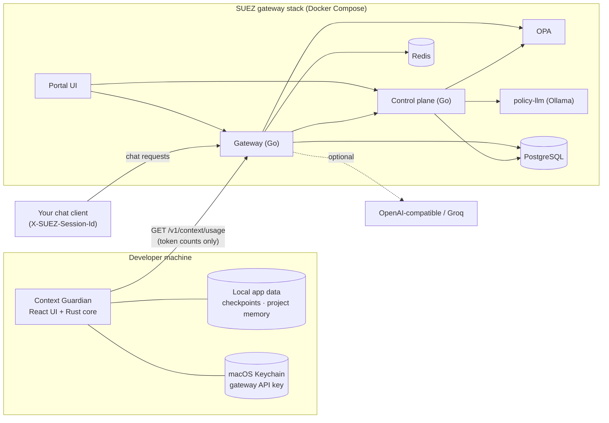

# SUEZ

**SUEZ** is a local-first AI governance gateway and the **SUEZ Context
Guardian** desktop app built on it.

The **gateway stack** sits between applications and AI models or tools. It
enforces grants, policies and quotas, and records an audit trail.
**Context Guardian** is a small floating widget that watches how full an AI
conversation's context window is. It saves a checkpoint before work is lost
and turns that checkpoint into a prompt for a fresh session.

> **Status: early-stage, local-development software.** Everything here runs on
> a developer machine with Docker Compose and a native macOS app. Nothing in
> this repository is production-hardened. See
> [Known issues and limitations](#known-issues-and-limitations).

---

## Contents

- [The problem](#the-problem)
- [Vision](#vision)
- [What exists today](#what-exists-today)
- [Feature status](#feature-status)
- [Architecture](#architecture)
- [Technology stack](#technology-stack)
- [Repository structure](#repository-structure)
- [Getting started](#getting-started)
- [Configuration](#configuration)
- [Testing](#testing)
- [Building the desktop app](#building-the-desktop-app)
- [Security and privacy](#security-and-privacy)
- [Context Guardian in depth](#context-guardian-in-depth)
- [Known issues and limitations](#known-issues-and-limitations)
- [Roadmap](#roadmap)
- [Contributing](#contributing)
- [License](#license)
- [Support](#support)
- [Documentation index](#documentation-index)

## The problem

Teams adopting AI face two separate problems:

1. **Ungoverned access.** Applications call models and tools directly, with no
   central place to grant access, apply policy, cap usage or audit what happened.
2. **Lost working context.** Long AI-assisted sessions silently approach the
   model's context limit. When the window fills, or a session has to be
   restarted, the decisions, progress and next steps live only in a
   conversation that is about to be truncated.

## Vision

A single control point for AI traffic, plus tooling that makes long
AI-assisted work resumable and honest:

- All AI calls flow through a gateway that knows *who* is calling *what*, under
  *which* policy.
- A desktop companion that measures context usage where it can, never invents
  numbers where it cannot, and preserves project state across sessions. It
  keeps a clear line between what was verified and what was merely reported.

The SaaS/enterprise direction is described in design documents under
[`docs/saas/`](docs/saas/). It is **planned, not implemented**.

## What exists today

**Gateway stack** (Docker Compose, `infra/compose/docker-compose.yml`):

- OpenAI-style `POST /v1/chat/completions` and `POST /v1/tools/execute`, each
  call going through:
  - identity resolution;
  - an access-grant check;
  - an OPA policy decision;
  - Redis-backed quotas and response caching;
  - an audit log.
- Model providers: an in-process **stub** (no external calls),
  **OpenAI-compatible** endpoints and **Groq**.
- A control plane for:
  - tenants, API keys and access requests/grants;
  - the model and tool catalog;
  - the policy lifecycle: draft, generate (with a local Ollama model),
    validate, test, publish, roll back;
  - the audit log.
- A React portal for admins and requesters, behind a local HTTPS edge (Caddy).
- **Per-session context-usage measurement** for chat requests tagged with
  `X-SUEZ-Session-Id`, served by `GET /v1/context/usage`. This requires
  migration `0006`.

**SUEZ Context Guardian** (`apps/context-guardian/`, Tauri 2 desktop app, tested on macOS):

- A floating, always-on-top usage monitor with two sources:
  - **Mock** (simulated, labelled `MOCK DATA`);
  - **SUEZ gateway** (measured by the gateway for one session id).
- An **85%** threshold that saves exactly one checkpoint **draft** and opens
  the editor. A **95%** threshold raises a critical warning.
- A structured checkpoint editor, local history, and a continuation-prompt
  generator with copy to clipboard.
- **Persistent project memory**: one versioned record per project. Every change
  is previewed and explicitly approved; revisions can be restored.
- **Evidence-aware progress**: a work item can be marked `verified` only with
  evidence from the same session. Carried-over claims become `reported`, and
  carried test results are labelled "NOT rerun".
- The gateway API key is kept in the macOS Keychain and never reaches the UI,
  checkpoint files or prompts.

## Feature status

Legend:
- ✅ **Implemented and tested**: automated tests exist and were run.
- 🟡 **Implemented, incompletely tested**.
- 🧩 **Partial**.
- 📝 **Planned**.
- ⛔ **Unsupported**.

| Area | Feature | Status | Notes |
| --- | --- | --- | --- |
| Context Guardian | Floating always-on-top widget | 🟡 | Window rendering and resizing are covered by native smoke tests. Dragging is checked by hand only. |
| Context Guardian | Mock usage source | ✅ | Always labelled `MOCK DATA`; it is not telemetry. |
| Context Guardian | 85% checkpoint draft (one per crossing, no duplicate after restart) | ✅ | Unit and native smoke tests (mock and gateway). |
| Context Guardian | 95% critical warning | ✅ | Unit and native smoke tests. |
| Context Guardian | Checkpoint editor, history, local JSON storage, schema v1→v2 with backup | ✅ | Rust and TypeScript unit tests; native smoke tests. |
| Context Guardian | Continuation prompt | ✅ | Includes a byte-for-byte compatibility test for legacy checkpoints. |
| Context Guardian | Gateway usage source (stale, unavailable and auth states) | ✅ | Tested against a throwaway gateway stack with the **free stub model** only. |
| Context Guardian | API key in macOS Keychain | 🟡 | Covered by the gateway smoke test. The direct Keychain round-trip test is opt-in (`--ignored`). Windows and Linux are untested. |
| Context Guardian | Persistent project memory (import, merge, approvals, revisions, recovery) | ✅ | New. Unit tests and a native smoke test. Local to one machine and not synced. |
| Context Guardian | Evidence-aware progress tracking | ✅ | Enforced in Rust and in the UI. |
| Context Guardian | Automatic summarisation of AI conversations | ⛔ | The app cannot read conversations; checkpoint content is written or pasted by you. |
| Context Guardian | Reading Claude.ai, Claude Code, ChatGPT/Codex or Cursor sessions | ⛔ | No such integration exists. Only traffic sent **through the SUEZ gateway** can be measured. |
| Context Guardian | Windows / Linux builds | ⛔ | Not built or tested. The release is Apple Silicon only and ad-hoc signed. |
| Gateway | Chat completions, tools, grants, OPA, quotas, cache, audit | 🟡 | Exercised by demo scripts. Automated Go tests exist only for context-usage code. |
| Gateway | Context-usage measurement and `GET /v1/context/usage` | ✅ | Go unit tests, plus an integration test against throwaway PostgreSQL/Redis. |
| Gateway | Provider-reported token counts (OpenAI-compatible / Groq) | 🟡 | Implemented. **Not tested against a live paid provider.** |
| Gateway | `models.context_window` management | 🧩 | Column exists after migration 0006. It can only be set with SQL; there is no API or UI yet. |
| Control plane | Tenants, keys, access workflow, catalog, policy lifecycle, audit API | 🟡 | No automated Go tests. Exercised manually and by demo scripts. |
| Control plane | JWT signature verification | ⛔ | JWT claims are decoded **without signature verification** in the local runtime. |
| Portal UI | Admin and requester UI | 🟡 | Type check and build only; no UI tests. |
| Platform | Enterprise SaaS on AWS (EKS, SSO, multi-tenancy) | 📝 | Design documents and experimental scripts only. Not verified. |
| Platform | Retention policy for context-usage measurements | 📝 | Rows are kept indefinitely. |

## Architecture



Checkpoints and project memory **stay on your machine**. The app sends the
gateway only a session id and the API key header, and receives token counts
and status.

Read more:
- [docs/ARCHITECTURE.md](docs/ARCHITECTURE.md): components, flows, data
  ownership and decisions.
- [docs/gateway-architecture.md](docs/gateway-architecture.md): gateway request
  flows, data model and APIs.
- Diagram sources:
  - [system overview](docs/architecture/system-overview.mmd)
  - [context monitoring](docs/architecture/context-monitoring-flow.mmd)
  - [checkpoint lifecycle](docs/architecture/checkpoint-lifecycle.mmd)
  - [deployment topology](docs/architecture/deployment-topology.mmd)

## Technology stack

| Layer | Technology |
| --- | --- |
| Desktop app | Tauri 2 (Rust), React 18, TypeScript 5, Vite 8, Vitest; `keyring` for the OS credential store; `reqwest` for HTTP |
| Gateway, control plane | Go 1.22 (`net/http`, `pgx`, `go-redis`) |
| Portal | React 18, TypeScript, Vite |
| Policy | Open Policy Agent (Rego); Ollama with a small open-weight model for policy drafting |
| Data | PostgreSQL 16, Redis 7 |
| Edge / runtime | Caddy 2, Docker Compose |

## Repository structure

```text
apps/
  context-guardian/     Tauri desktop app (React UI in src/, Rust core in src-tauri/)
  gateway/              Go gateway service
  control-plane/        Go control-plane service
  portal-ui/            React admin/requester portal
infra/
  compose/              docker-compose.yml for the local stack
  db/                   SQL migrations and demo seeds
  opa/                  OPA image and Rego policies
  policy-llm/           Ollama image for policy drafting
  secrets/              (empty) optional file-backed provider keys; contents git-ignored
  tls/                  Caddyfile; generated certificates are git-ignored
packages/shared/        placeholder
scripts/                demo, backup/restore, TLS bootstrap and experimental AWS scripts
docs/                   architecture, operations, testing, security and design docs
.github/workflows/      CI (type checks, unit tests, builds; no secrets, no deploys)
```

## Getting started

Prerequisites:

| For | You need |
| --- | --- |
| Gateway stack | Docker (Desktop or compatible) with Compose v2; GNU Make |
| Context Guardian | macOS on Apple Silicon (the tested platform); Node.js ≥ 20.19 (22 used in CI); Rust (stable) via rustup; Xcode Command Line Tools |
| Go development (optional) | Go 1.22, or run Go in the `golang:1.22-alpine` Docker image |

Full instructions: [docs/INSTALLATION.md](docs/INSTALLATION.md) and
[docs/DEVELOPMENT.md](docs/DEVELOPMENT.md).

### 1. Run the gateway stack

```sh
cp .env.example .env    # optional; Compose defaults work without it
make up                 # builds and starts all services (first run pulls an Ollama model)
```

| Service | URL |
| --- | --- |
| Portal over HTTPS (needs `127.0.0.1 suez.acrosystemsinc.ai` in `/etc/hosts`; see [docs/local-development.md](docs/local-development.md)) | `https://suez.acrosystemsinc.ai:5443` |
| Portal (direct) | `http://localhost:5173` |
| Gateway health | `http://localhost:8080/healthz` |
| Control-plane health | `http://localhost:8081/healthz` |
| OPA | `http://localhost:8181/v1/data/suez/authz/allow` |
| Ollama | `http://localhost:11434/api/tags` |

Stop the stack with `make down`. Note that `make clean` **deletes the database
volume**.

A fresh database is seeded with **demo data and a demo API key**. These are
for local use only. See [docs/operations.md](docs/operations.md) for portal
workflows.

### 2. Run Context Guardian

```sh
cd apps/context-guardian
npm ci
npm run tauri dev
```

It starts with the **Mock** source. To measure real requests:
1. Apply migration `0006` to your database (see below).
2. Set `models.context_window` for your models.
3. Choose **SUEZ gateway** in Settings and store an API key.
4. Send `X-SUEZ-Session-Id: <id>` with your chat requests.

Step by step: [apps/context-guardian/README.md](apps/context-guardian/README.md#gateway-mode).

### Database migrations

Migrations in `infra/db/migrations/` run automatically **only when the
PostgreSQL volume is first created**. To add `0006_context_guardian.sql` to an
existing database, apply it by hand (it is additive and idempotent); see
[infra/db/README.md](infra/db/README.md). Back up first with
`./scripts/backup-postgres.sh`.

## Configuration

All configuration uses environment variables with safe local defaults. Copy
`.env.example` to `.env` (git-ignored) to override them. Provider API keys can
be supplied as environment variables or as files in `infra/secrets/`.
Context Guardian keeps its settings in its own app-data directory and its API
key in the Keychain.

The full reference is in [docs/CONFIGURATION.md](docs/CONFIGURATION.md).

## Testing

| Suite | Command | Needs |
| --- | --- | --- |
| Context Guardian type check | `npm run typecheck` (in `apps/context-guardian`) | Node |
| Context Guardian unit tests (Vitest) | `npm test` | Node |
| Context Guardian Rust tests | `npm run build && npm run test:rust` | Rust, built frontend |
| Native smoke test, mock | `npm run smoke` | macOS desktop session, debug build |
| Native smoke test, project memory | `npm run smoke:memory` | macOS desktop session, debug build |
| Native smoke test, gateway | `npm run smoke:gateway` | Docker; starts a throwaway `cg-test-*` stack and uses only the free stub model |
| Go vet and unit tests | `go vet ./... && go test ./...` (in `apps/gateway`, `apps/control-plane`) | Go 1.22 or Docker |
| Gateway integration test | `go test -tags integration ./...` with `DATABASE_URL` and `REDIS_URL` | Throwaway PostgreSQL and Redis with all migrations |
| Portal UI build | `npm ci && npm run build` (in `apps/portal-ui`) | Node |

CI ([.github/workflows/ci.yml](.github/workflows/ci.yml)) runs the type
checks, Vitest, Rust tests, Go vet and unit tests, and the portal build. No
test makes paid provider calls. Details, including what each suite covers and
what it does not: [docs/TESTING.md](docs/TESTING.md).

## Building the desktop app

```sh
cd apps/context-guardian
npm ci
npm run tauri build
```

Output:
- `src-tauri/target/release/bundle/macos/SUEZ Context Guardian.app`
- `src-tauri/target/release/bundle/dmg/SUEZ Context Guardian_<version>_aarch64.dmg`

Builds are ad-hoc signed and **not notarized**. No public binary release
exists. See [docs/RELEASE.md](docs/RELEASE.md).

## Security and privacy

- **Local data stays local.** Checkpoints, project memory, revisions and
  settings are plain JSON files in the app-data directory. They are never
  uploaded.
- **What goes to the gateway:** the session id and the API key header. **What
  comes back:** token counts, percentage, model name, measurement source and
  status.
- **Secrets:**
  - The desktop API key lives only in the OS credential store and in Rust
    memory.
  - Rust refuses to save a checkpoint or memory record, or copy a prompt, that
    contains it.
  - Provider keys for the gateway come from `.env` or `infra/secrets/`, both
    git-ignored.
- **Local-only runtime.** The gateway stack is not hardened:
  - JWT signatures are not verified;
  - a demo API key is seeded;
  - the default database password is `suez`;
  - CORS is `*`;
  - ports are published on all interfaces.

  Do not expose it to untrusted networks.

Details: [docs/SECURITY-AND-PRIVACY.md](docs/SECURITY-AND-PRIVACY.md) and
[docs/DATA-RETENTION.md](docs/DATA-RETENTION.md). To report a vulnerability,
follow [SECURITY.md](SECURITY.md).

## Context Guardian in depth

### Checkpoint lifecycle

1. **Monitor.** A usage reading arrives from Mock or the gateway.
2. **Detect.** At 85% (configurable), one **draft** is saved immediately and the
   editor opens. It re-arms only after usage drops 5 points below the threshold.
3. **Draft.** The draft is pre-filled from the project's memory and the newest
   checkpoint of the same project. Carried "verified" items become "reported".
4. **Edit and save.** Changes are autosaved. Writes are atomic and read back to
   verify them; a version-1 file is backed up before it is upgraded.
5. **Finalize.** Mark the checkpoint final. It appears in history (filterable by
   project).
6. **Continue.** Copy the continuation prompt and paste it into a new session.
7. **Remember (optional, explicit).** Propose a project-memory update from a
   final checkpoint, review the preview, and approve it.

Diagram: [checkpoint-lifecycle.mmd](docs/architecture/checkpoint-lifecycle.mmd).

### Context-usage measurement limitations

- **Only conversations routed through the SUEZ gateway** with
  `X-SUEZ-Session-Id` can be measured. Direct sessions in Claude.ai, Claude
  Code, ChatGPT/Codex, Cursor or any other client are **not** visible. Owning
  a provider API key does not give access to them.
- A percentage needs `models.context_window`. Without it, token counts are
  shown with no percentage.
- Each reading is labelled with its source:

  | Label | Meaning |
  | --- | --- |
  | `provider_reported` | Usage returned by the provider |
  | `gateway_estimate` | Stub model, about characters ÷ 4 |
  | `unavailable` | No usage returned |
  | `MOCK DATA` | Simulated |
  | `STALE` | No successful poll within 3 × the poll interval |

  Stale and unavailable readings never trigger checkpoints.
- Provider-reported counts are implemented but **have not been verified
  against a live paid provider**.

### Persistent project memory

Implemented in this repository:
- Stable project ids. Names never trigger a merge.
- Import from a checkpoint, and merges from final checkpoints, each with a
  preview and explicit approval.
- Approval records, which never execute anything.
- Revision checks, a no-removal rule, the latest 50 revisions kept, restore,
  and quarantine of corrupt files.

Memory is **local to one machine** and is not synchronised. See
[apps/context-guardian/README.md](apps/context-guardian/README.md#project-memory).

### Local storage

| OS | App-data directory |
| --- | --- |
| macOS | `~/Library/Application Support/ai.acrosystems.suez.contextguardian/` |
| Windows (untested) | `%APPDATA%\ai.acrosystems.suez.contextguardian\` |
| Linux (untested) | `~/.local/share/ai.acrosystems.suez.contextguardian/` |

Override it with `CONTEXT_GUARDIAN_DATA_DIR`.

## Known issues and limitations

- Context measurement is limited to gateway-routed requests (see above).
- Provider-reported counts are untested against live paid providers.
- Context Guardian:
  - is built and tested only on macOS (Apple Silicon);
  - is ad-hoc signed and not notarized, so macOS may ask again for Keychain
    access after a rebuild;
  - window dragging is verified by hand only.
- If the Keychain cannot be read, the secret guard cannot compare and allows
  the save, so that drafts are never lost.
- Backups of upgraded v1 checkpoints are restored by copying the file back by
  hand; there is no UI for it.
- Gateway stack:
  - local-development security only (see above);
  - no automated tests for most gateway and control-plane features;
  - four Go files are not `gofmt`-clean;
  - `context_usage_measurements` has no retention policy;
  - `context_window` can be set only with SQL.
- Migration `0006` is not applied automatically to existing databases.
- `docs/` contains design documents (PDF/DOCX/Markdown) describing planned
  enterprise features. They are not descriptions of implemented behaviour.

## Roadmap

See [docs/ROADMAP.md](docs/ROADMAP.md), which separates implemented,
in-progress, planned and blocked work.

## Contributing

Contributions are welcome. Read [CONTRIBUTING.md](CONTRIBUTING.md) for setup,
tests, coding standards and secret-handling rules, and follow the
[Code of Conduct](CODE_OF_CONDUCT.md).

## License

[MIT](LICENSE) © 2026 Shushruth_Bharadwaj.

## Support

Open a [GitHub issue](https://github.com/shushruth21/SUEZ-AI/issues) with
reproduction steps. Never include API keys, `.env` contents, checkpoint files
or project memory. See [SUPPORT.md](SUPPORT.md). Report security issues
privately as described in [SECURITY.md](SECURITY.md).

## Documentation index

| Document | Purpose |
| --- | --- |
| [docs/ARCHITECTURE.md](docs/ARCHITECTURE.md) | System architecture, flows, data ownership |
| [docs/gateway-architecture.md](docs/gateway-architecture.md) | Gateway and control-plane flows, data model, APIs |
| [docs/INSTALLATION.md](docs/INSTALLATION.md) | Installing and building |
| [docs/DEVELOPMENT.md](docs/DEVELOPMENT.md) | Day-to-day development |
| [docs/local-development.md](docs/local-development.md) | Compose stack, HTTPS edge, backups |
| [docs/CONFIGURATION.md](docs/CONFIGURATION.md) | Environment variables and settings |
| [docs/TESTING.md](docs/TESTING.md) | Test suites, coverage and gaps |
| [docs/SECURITY-AND-PRIVACY.md](docs/SECURITY-AND-PRIVACY.md) | Credentials, data boundaries, security limitations |
| [docs/DATA-RETENTION.md](docs/DATA-RETENTION.md) | What is stored, where, and for how long |
| [docs/RELEASE.md](docs/RELEASE.md) | Release preparation and limitations |
| [docs/ROADMAP.md](docs/ROADMAP.md) | Status of planned work |
| [docs/TROUBLESHOOTING.md](docs/TROUBLESHOOTING.md) | Common problems |
| [docs/operations.md](docs/operations.md) | Portal guide for admins and requesters |
| [docs/implementation.md](docs/implementation.md) | Notes on portal and demo implementation |
| [docs/local-architecture.md](docs/local-architecture.md) | Short local-runtime overview |
| [apps/context-guardian/README.md](apps/context-guardian/README.md) | Context Guardian reference |
| [scripts/README-demo.md](scripts/README-demo.md) | Demo scripts |
| [docs/saas/](docs/saas/) | Enterprise SaaS design (planned) |
| [docs/suez-enterprise-product-must-haves.md](docs/suez-enterprise-product-must-haves.md) | Enterprise requirements (planned) |
| `docs/*.pdf`, `docs/*/*.pdf`, `docs/*.docx` | Product and architecture design documents (planning material) |
