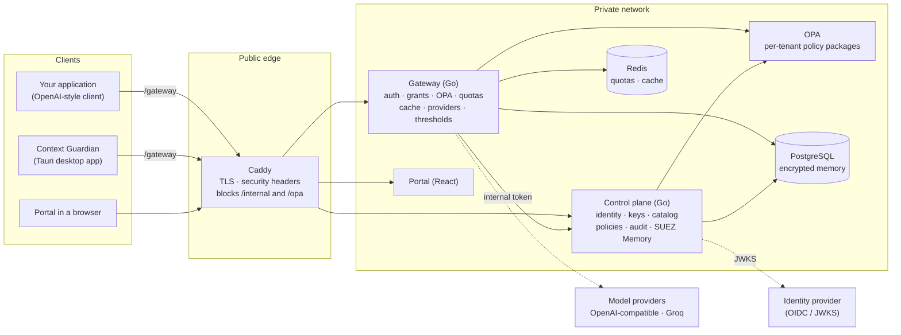

# SUEZ

**SUEZ** is a multi-tenant AI governance gateway, plus **SUEZ Context
Guardian**, a desktop companion app built on top of it.

- **The gateway** sits between your applications and AI models or tools. For
  every call it checks who is calling, applies access grants, OPA policies and
  quotas, and writes an audit trail.
- **SUEZ Memory** stores session evidence and reviewed checkpoints, so long AI
  work can continue in a fresh session without losing decisions or progress.
- **Context Guardian** is a small floating window that shows how full a
  conversation's context window is. It warns you before the window fills and
  helps you checkpoint and continue.

[](https://github.com/shushruth21/SUEZ-AI/actions/workflows/ci.yml)
[](LICENSE)

> **Status: pre-release, ready for staging.** The production configuration has
> been hardened and verified locally: unit, policy and end-to-end tests,
> vulnerability scans, and a backup/restore drill. It has **not** yet run real
> production traffic, a cloud KMS, a paid model provider or a multi-replica
> load test. See [Known limitations](#known-limitations) and
> [docs/production/VERIFICATION.md](docs/production/VERIFICATION.md).

---

## Contents

- [Why SUEZ](#why-suez)
- [Features](#features)
- [Architecture](#architecture)
- [Quick start](#quick-start)
- [Sharing a staging environment with testers](#sharing-a-staging-environment-with-testers)
- [Deploying to production](#deploying-to-production)
- [API overview](#api-overview)
- [Security model](#security-model)
- [Testing](#testing)
- [Repository layout](#repository-layout)
- [Technology stack](#technology-stack)
- [Known limitations](#known-limitations)
- [Documentation](#documentation)
- [Contributing](#contributing)
- [License](#license)

## Why SUEZ

Teams adopting AI hit two problems:

1. **Ungoverned access.** Applications call models and tools directly. There
   is no single place to grant access, apply policy, cap spending or see what
   happened.
2. **Lost working context.** Long AI-assisted sessions quietly approach the
   model's context limit. When the window fills, decisions and progress are
   lost with the conversation.

SUEZ puts one control point in front of AI traffic, and keeps the working
state of long sessions in a form that can be reviewed and carried forward.

## Features

### Gateway and control plane

| Feature | Details |
| --- | --- |
| OpenAI-compatible API | `POST /v1/chat/completions` (including streaming) and `POST /v1/tools/execute` |
| Identity | Scoped API keys, and JWTs verified against your identity provider (OIDC discovery, JWKS, key rotation, fail closed) |
| Authorization | One permission table for every route. Keys carry scopes, expiry, model and tool allowlists and rate limits, and can never exceed the key that created them |
| Multi-tenancy | Every query is scoped to the caller's tenant; covered by end-to-end isolation tests |
| Policy | OPA (Rego) policies per tenant: draft, generate with a local model, validate, test in a sandbox, publish, roll back |
| Quotas and caching | Redis-backed quotas that fail closed; a response cache keyed on everything that affects the answer, including the policy version |
| Providers | Built-in stub model (free, no network), OpenAI-compatible endpoints and Groq, with safe retries and normalized errors |
| Context thresholds | Per tenant and model: notice, checkpoint, warning and optional hard block, reported in `X-SUEZ-Context-*` response headers |
| Audit | Every decision is recorded with a trace id; secrets are redacted before anything is stored |

### SUEZ Memory

- Tenant-scoped sessions that record evidence (what really happened) apart
  from generated text.
- Summaries that cite their sources.
- Checkpoints that start as drafts and must be approved before reuse.
- Continuation prompts built within a token budget.
- Injection into a chat request only when asked for, allowed by policy and
  audited.
- Export, deletion and retention settings.
- Content encrypted at rest (AES-256-GCM envelope encryption) and secrets
  redacted before storage.

### Context Guardian (macOS desktop app)

- Always-on-top usage meter. Its source is either the SUEZ gateway, measured
  per session, or a clearly labelled mock.
- Uses the tenant's thresholds. When usage crosses the checkpoint threshold
  it saves one draft and opens the editor.
- Checkpoint editor, history and continuation prompts, plus a panel of
  checkpoints stored on the server.
- Versioned project memory: every change is previewed and approved, and
  revisions can be restored.
- Evidence-aware progress tracking: an item is "verified" only with evidence
  from the same session.
- The API key lives in the macOS Keychain and never reaches the UI, files or
  prompts.

## Architecture



A chat request goes through: identity → permission → model grant and key
allowlist → OPA decision → quota → cache → provider → context thresholds and
memory capture → audit.

Details:
- [docs/production/ARCHITECTURE.md](docs/production/ARCHITECTURE.md): trust
  boundaries, data flow, isolation and caching.
- [docs/ARCHITECTURE.md](docs/ARCHITECTURE.md): components and Context Guardian.
- [docs/adr/](docs/adr/): architecture decision records.

## Quick start

### Prerequisites

| For | You need |
| --- | --- |
| Gateway stack | Docker with Compose v2, GNU Make |
| Context Guardian | macOS on Apple Silicon, Node.js 22, Rust (stable), Xcode Command Line Tools |
| Go development (optional) | Go 1.26, or use the `golang:1.26` Docker image |

### 1. Start the development stack

```sh
cp .env.example .env   # optional; the defaults work for local development
make up
```

| Service | URL |
| --- | --- |
| Portal | http://localhost:5173 |
| HTTPS edge | https://localhost:5443 (self-signed certificate; see [docs/local-development.md](docs/local-development.md)) |
| Gateway | http://localhost:8080/healthz |
| Control plane | http://localhost:8081/healthz |

The development stack seeds a demo tenant and the well-known key
`suez-demo-admin-key`. **It is for your machine only;** production mode
refuses to start with these settings.

Try a governed chat call using the free stub model:

```sh
curl -s http://localhost:8080/v1/chat/completions \
  -H "Authorization: Bearer suez-demo-admin-key" \
  -H "Content-Type: application/json" \
  -H "X-SUEZ-Session-Id: demo-1" \
  -d '{"model":"demo-model","messages":[{"role":"user","content":"Hello"}]}' -i
```

The response carries `X-SUEZ-Trace-Id` and `X-SUEZ-Context-Status`. Once the
model has a context window configured, it also carries
`X-SUEZ-Context-Percent`.

Stop the stack with `make down`. `make clean` also **deletes the database
volume**.

### 2. Run Context Guardian

```sh
cd apps/context-guardian
npm ci
npm run tauri dev
```

In **Settings**, choose **SUEZ gateway**, enter the gateway URL and save an API
key (it goes to the Keychain). See
[apps/context-guardian/README.md](apps/context-guardian/README.md).

To build an installer into the repository root (git-ignored):

```sh
make dmg   # → ./ContextGuardian.dmg
```

## Sharing a staging environment with testers

`scripts/staging.sh` runs a staging copy of SUEZ on one machine in
**production mode** and publishes it through a temporary Cloudflare tunnel.
No demo credentials exist there. Each tester gets an isolated tenant and
expiring keys.

```sh
bash scripts/staging.sh up              # start; prints the public URL
bash scripts/staging.sh add-tester alice
bash scripts/staging.sh list
bash scripts/staging.sh revoke alice
bash scripts/staging.sh down            # stop and keep data (destroy removes it)
```

Each tester gets `~/.suez-staging/testers/<name>.txt` (URLs, keys and steps)
and `ContextGuardian.dmg`. The tunnel URL changes on every restart. The tester
guide is [docs/TESTING-STAGING.md](docs/TESTING-STAGING.md).

## Deploying to production

Production uses `infra/compose/docker-compose.prod.yml`. Only the Caddy edge
is published, TLS comes from ACME, and every secret is read from a file.
In short:

1. Copy `.env.production.example` and fill it in:
   - identity provider issuer and audience;
   - CORS origins;
   - trusted proxies;
   - secret file paths.
2. Run migrations with `scripts/migrate.sh`, which uses an advisory lock and
   records each migration it applies.
3. Create the first tenant and key with
   `control-plane bootstrap --tenant-slug … --tenant-name …`.
4. Work through
   [docs/production/GO-LIVE-CHECKLIST.md](docs/production/GO-LIVE-CHECKLIST.md).

The full guide is [docs/production/DEPLOYMENT.md](docs/production/DEPLOYMENT.md).
Runbooks cover rollback, incident response, key rotation, backup and restore,
and data retention.

## API overview

All gateway routes need `Authorization: Bearer <api-key or JWT>` (or
`X-API-Key`).

**Gateway** (`/gateway` behind the edge):

| Method and path | Permission | Purpose |
| --- | --- | --- |
| `POST /v1/chat/completions` | `gateway.invoke` | Governed chat completion; `stream: true` supported |
| `POST /v1/tools/execute` | `gateway.tools` | Governed tool call |
| `GET /v1/context/usage?session=<id>` | `usage.read` | Latest context usage for the caller's session |
| `GET /v1/identity` | `session.read` | Who am I (tenant, actor, scopes) |
| `GET /v1/observability` | `usage.read` | Usage summary for the tenant |
| `/v1/memory/*` | `memory.*` | SUEZ Memory, proxied to the control plane |

**Control plane** (`/control-plane` behind the edge), under `/api/v1`:

| Area | Routes |
| --- | --- |
| Session | `GET auth/session` |
| Tenants | `GET, POST tenants` (platform admin) |
| Keys and users | `api-keys`, `users` (`apikeys.manage`, `users.manage`) |
| Access | `access-requests`, `access-requests/{id}/approve or deny`, `access-grants` |
| Catalog | `models`, `tools` |
| Policies | `policies`, `generate`, `{id}/validate`, `{id}/tests`, `{id}/tests/run`, `{id}/publish`, `{id}/rollback`, `{id}/versions` |
| Audit | `audit-log`, `audit-log/traces/{traceId}` |
| Memory | `memory/sessions`, `…/checkpoints`, `memory/continuations`, `memory/settings`, `memory/context-policies`, `memory/retrievals`, export, delete and retention |

Scopes bundle permissions: `read-only`, `gateway-inference`, `policy-admin`,
`audit-reader`, `tenant-admin` and `platform-admin`. The full reference is
[docs/API.md](docs/API.md).

## Security model

- **Production by default.** `SUEZ_ENV` defaults to `production` and the
  services refuse to start with unsafe settings:
  - demo credentials;
  - `dev-hs256` JWTs;
  - `*` CORS;
  - a missing internal token or data key.
- **Authentication:**
  - JWTs need an asymmetric algorithm and must pass issuer, audience and time
    checks.
  - API keys are random, stored only as SHA-256 hashes, expirable, revocable
    and attributable to whoever created them.
- **Authorization:** each route maps to exactly one permission, and a route
  missing from the table is refused. Keys cannot grant more than their
  creator holds.
- **Tenant isolation:**
  - Every query is tenant-scoped.
  - Each tenant's OPA policies load into their own package, and policy drafts
    run in a sandbox.
  - Policy changes across replicas are serialized by a PostgreSQL advisory
    lock.
- **Secrets:**
  - Secrets are redacted from responses, logs, audit records, cache keys and
    memory.
  - Memory content is encrypted at rest.
  - The edge blocks `/internal*` and `/opa*`.

Read [docs/production/THREAT-MODEL.md](docs/production/THREAT-MODEL.md).
Report vulnerabilities privately as described in [SECURITY.md](SECURITY.md).

## Testing

| Suite | Command | Result on this branch |
| --- | --- | --- |
| Control plane, Go unit tests | `go test ./...` in `apps/control-plane` | 24 pass |
| Gateway, Go unit tests | `go test ./...` in `apps/gateway` | 25 pass |
| Known vulnerabilities | `govulncheck ./...` (both services) | none found |
| OPA policies | `opa test infra/opa/policies` | 8/8 pass |
| End-to-end (full stack, mock IdP and provider) | `sh scripts/e2e.sh -v` | 11/11 groups pass |
| Context Guardian (TypeScript) | `npm test` in `apps/context-guardian` | 106 pass |
| Context Guardian (Rust) | `npm run test:rust` | 45 pass |
| Portal | `npm run build` in `apps/portal-ui` | builds |
| npm audit (production dependencies) | `npm audit --omit=dev` | 0 vulnerabilities |

No test calls a paid provider. Go does not need to be installed: see
[docs/TESTING.md](docs/TESTING.md) for the Docker commands. CI
([.github/workflows/ci.yml](.github/workflows/ci.yml)) runs all of these
except the native desktop smoke tests. Exact commands and outputs are in
[docs/production/VERIFICATION.md](docs/production/VERIFICATION.md).

## Repository layout

```text
apps/
  gateway/            Go gateway service
  control-plane/      Go control plane (identity, policy, audit, SUEZ Memory)
  portal-ui/          React admin and requester portal
  context-guardian/   Tauri desktop app (React UI in src/, Rust core in src-tauri/)
infra/
  compose/            docker-compose.yml (dev), .prod.yml, .staging.yml, .e2e.yml
  db/                 numbered SQL migrations and development seeds
  opa/                OPA image and Rego policies with tests
  tls/                Caddyfiles for dev, staging and production
  policy-llm/         Ollama image for policy drafting
  secrets/            file-backed secrets (contents git-ignored)
scripts/              migrate, e2e, staging, build-dmg, backup/restore, demos
tests/e2e/            full-stack acceptance tests
docs/                 guides, production runbooks, ADRs, design documents
.github/              CI, issue and pull request templates, Dependabot
```

## Technology stack

| Layer | Technology |
| --- | --- |
| Services | Go 1.26 (`net/http`, `pgx` v5, `go-redis` v9, `golang-jwt` v5) |
| Policy | Open Policy Agent 1.4 (Rego); Ollama for policy drafting |
| Data | PostgreSQL 16, Redis 7 |
| Edge | Caddy 2 |
| Portal | React 18, TypeScript, Vite |
| Desktop | Tauri 2 (Rust), React 18, TypeScript, Vitest |
| Delivery | Docker Compose, GitHub Actions, non-root container images |

## Known limitations

These are summarised here; the full, verified list is in
[docs/production/LIMITATIONS.md](docs/production/LIMITATIONS.md).

- **Encryption keys:** only a local key provider exists; there is no cloud KMS
  integration yet.
- **Provider and load testing:**
  - Provider calls were verified against a protocol-faithful mock, not a paid
    provider.
  - Multi-replica policy coordination has not been load-tested.
- **Context measurement** covers only traffic sent through the SUEZ gateway.
  Context Guardian cannot see sessions in Claude.ai, ChatGPT, Cursor or other
  clients.
- **Checkpoint drafts** copy and cite stored records; they are not
  LLM-generated summaries.
- **Context Guardian:**
  - It is built and tested on macOS (Apple Silicon) only.
  - The `.dmg` is ad-hoc signed and not notarized, so testers right-click →
    **Open** the first time.
- **No tagged release yet.**

## Documentation

| Document | Purpose |
| --- | --- |
| [docs/production/](docs/production/README.md) | Threat model, deployment, configuration, runbooks, go-live checklist, verification |
| [docs/API.md](docs/API.md) | HTTP API reference and permissions |
| [docs/adr/](docs/adr/) | Architecture decision records |
| [docs/ARCHITECTURE.md](docs/ARCHITECTURE.md) | Components and Context Guardian architecture |
| [docs/INSTALLATION.md](docs/INSTALLATION.md) | Installing and building |
| [docs/DEVELOPMENT.md](docs/DEVELOPMENT.md) | Day-to-day development |
| [docs/CONFIGURATION.md](docs/CONFIGURATION.md) | Development configuration |
| [docs/TESTING.md](docs/TESTING.md) | Test suites and what they cover |
| [docs/TESTING-STAGING.md](docs/TESTING-STAGING.md) | Guide for staging testers |
| [docs/SECURITY-AND-PRIVACY.md](docs/SECURITY-AND-PRIVACY.md) | Credentials and data boundaries |
| [docs/THIRD-PARTY-AND-TOOLING.md](docs/THIRD-PARTY-AND-TOOLING.md) | Claude-Mem and REA boundaries |
| [docs/TROUBLESHOOTING.md](docs/TROUBLESHOOTING.md) | Common problems |
| [docs/ROADMAP.md](docs/ROADMAP.md) | What is planned next |
| [CHANGELOG.md](CHANGELOG.md) | Notable changes |
| [docs/saas/](docs/saas/) and `docs/*.pdf` | Enterprise SaaS design material (planned, not implemented) |

## Contributing

Read [CONTRIBUTING.md](CONTRIBUTING.md) before opening a pull request, and
follow the [Code of Conduct](CODE_OF_CONDUCT.md). For help, see
[SUPPORT.md](SUPPORT.md).

## License

[MIT](LICENSE) © 2026 Shushruth_Bharadwaj.
