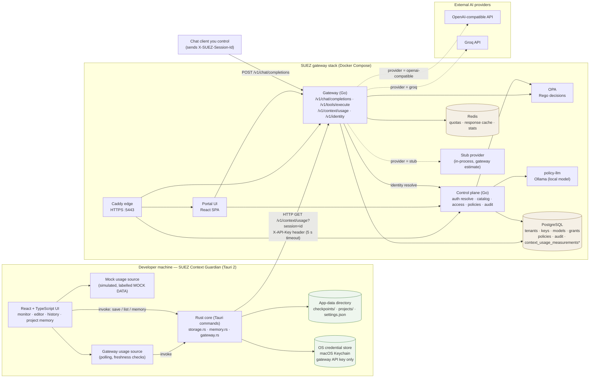
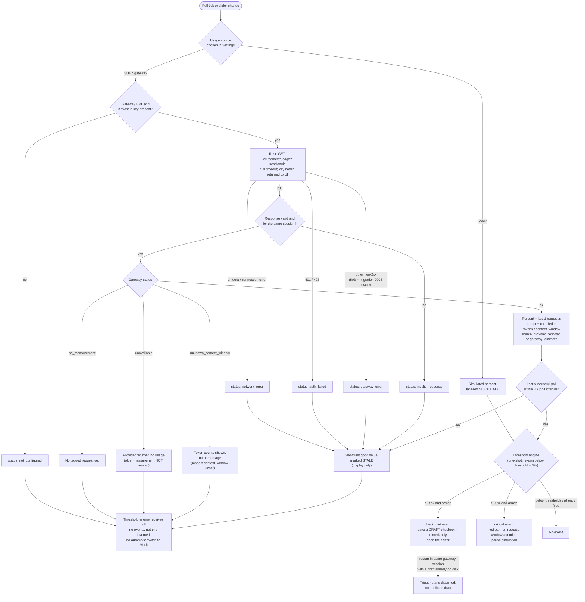
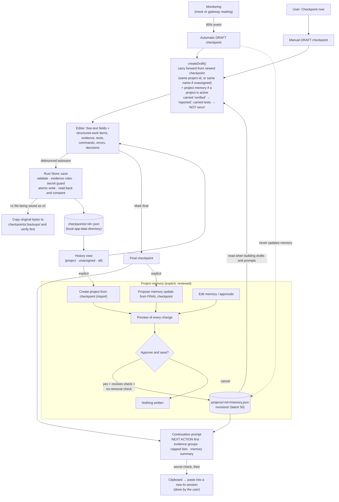
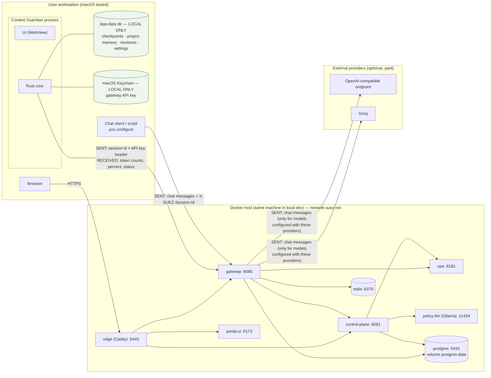

# SUEZ Architecture

This document describes the architecture **as implemented in this repository**.
Plans are marked **Planned** and kept in their own section. For the gateway's
request flows, data model and API in detail, see
[gateway-architecture.md](gateway-architecture.md).

Editable diagram sources (Mermaid) live in [`docs/architecture/`](architecture/):

| Diagram | Source |
| --- | --- |
| System overview | [system-overview.mmd](architecture/system-overview.mmd) |
| Context-monitoring flow | [context-monitoring-flow.mmd](architecture/context-monitoring-flow.mmd) |
| Checkpoint lifecycle | [checkpoint-lifecycle.mmd](architecture/checkpoint-lifecycle.mmd) |
| Deployment topology | [deployment-topology.mmd](architecture/deployment-topology.mmd) |

The diagrams below are copies of those files; edit the `.mmd` file first and
copy it here (see [DEVELOPMENT.md](DEVELOPMENT.md#diagrams)).

---

## 1. Components

SUEZ has two independently runnable parts that talk over one HTTP endpoint.

| Component | Path | Language / stack | Responsibility |
| --- | --- | --- | --- |
| **SUEZ Context Guardian** | `apps/context-guardian/` | Tauri 2, Rust, React 18, TypeScript, Vite | Desktop widget: shows context usage, saves checkpoint drafts at 85 %, warns at 95 %, keeps local checkpoint history and project memory, builds continuation prompts. |
| **Gateway** | `apps/gateway/` | Go 1.22, net/http, pgx, go-redis | Runtime enforcement for `/v1/chat/completions` and `/v1/tools/execute`: identity, grants, OPA decision, quotas, response cache, provider call, audit. Records per-session context usage and serves `GET /v1/context/usage`. |
| **Control plane** | `apps/control-plane/` | Go 1.22 | Identity resolution for the gateway, tenants, API keys, access requests/grants, model and tool catalog, policy lifecycle (draft → validate → test → publish → rollback), audit log API. |
| **Portal UI** | `apps/portal-ui/` | React 18, TypeScript, Vite | Admin and requester web UI for the control plane and gateway. |
| **OPA** | `infra/opa/` | Open Policy Agent, Rego | Allow/deny decisions with reasons. |
| **policy-llm** | `infra/policy-llm/` | Ollama (local open-weight model) | Natural-language → Rego draft generation for the control plane. |
| **PostgreSQL** | `infra/db/` | PostgreSQL 16 | Configuration, grants, policies, audit log; context-usage measurements after migration 0006. |
| **Redis** | Compose service | Redis 7 | Gateway quotas, response cache, counters. |
| **Edge** | `infra/tls/Caddyfile` | Caddy 2 | Local HTTPS termination and path routing. |

`packages/shared/` is a placeholder (README only).

## 2. System overview

The only connection between the desktop app and the gateway stack is the
Rust core calling `GET /v1/context/usage`. The app does not proxy chat traffic.
Chat requests are sent to the gateway by a client you control; for them to be
measured, that client must add `X-SUEZ-Session-Id`.

## 3. Context Guardian (desktop application)

### 3.1 Frontend / backend boundary

| Layer | Owns | Never does |
| --- | --- | --- |
| **React UI** (`src/`) | Rendering, the threshold engine (`guardian/threshold.ts`), draft construction and carry-forward (`guardian/checkpoint.ts`), memory proposals and diffs (`guardian/memory.ts`), prompt text (`guardian/prompt.ts`), usage sources (`usage/`). | Touch the file system or network directly; see the API key. |
| **Rust core** (`src-tauri/src/`) | All persistence (`storage.rs`, `memory.rs`), validation, evidence rules, secret guard, Keychain access and gateway HTTP calls (`gateway.rs`), exposed as Tauri commands in `lib.rs`. | Return the API key to the UI; write it to disk or logs. |

Validation that protects data is enforced in Rust even when the UI already
checks it: schema and id validation, the "verified needs same-session
evidence" rule, memory revision checks, the no-removal rule, and the secret guard.

### 3.2 Usage sources

`UsageSource` (`src/usage/source.ts`) has two implementations:

- **Mock** — a simulated percentage (slider / simulate). Every surface and every
  saved checkpoint labels it `MOCK DATA` / `simulated: true`.
- **Gateway** — polls the gateway through Rust and interprets the result
  (`gatewayReading.ts`). Only a fresh reading with status `ok` produces a
  percentage for the threshold engine.

The app never switches source automatically.

### 3.3 Context-usage measurement flow

**What is measured.** For each chat request that carries `X-SUEZ-Session-Id`,
the gateway stores one row with the request's prompt + completion tokens, the
model, the provider, the cache status and a **source** label:

| Source | Meaning |
| --- | --- |
| `provider_reported` | The upstream provider (OpenAI-compatible or Groq) returned a `usage` object. |
| `gateway_estimate` | The in-process **stub** model; the gateway estimates tokens (characters ÷ 4). Not provider telemetry. |
| `unavailable` | The provider returned no usage. An older measurement is **not** reused. |

Because chat clients resend the whole conversation, the **latest** row is the
current occupancy; rows are never summed. A percentage exists only when the
model has `models.context_window` set. In the app, `MOCK DATA` (simulated),
`ESTIMATE` (stub), `STALE` (no successful poll within 3 × poll interval) and
`NO DATA` are shown explicitly.

**What is not measured.** Conversations that do not pass through the SUEZ
gateway with the session header — for example Claude.ai, Claude Code, ChatGPT,
Codex or Cursor talking to their providers directly. An API key for a provider
does not give access to those sessions, and the app has no integration that
reads them.

### 3.4 Checkpoint creation and persistence

- **Drafts** are created by the 85 % event or manually. The draft is saved
  immediately, then edited with debounced autosave. After an app restart a
  gateway session that already has an automatic draft does not get a second one.
- **Content is user-authored.** The app cannot read the AI conversation; it
  pre-fills a draft only from earlier checkpoints and project memory.
- **Schema.** Version 1 and 2 files are read; version 2 is written. A v1 file
  is upgraded only when it is saved again, after its original bytes are copied
  to `checkpoints/.backups/` and verified. Unknown future versions and
  unreadable files are listed as skipped and never overwritten.
- **Writes** are atomic (temp file, `fsync`, rename) and read back for comparison.
- **Project memory** is one versioned record per project (stable id). Every
  change goes through a preview and explicit approval, a revision check and a
  no-removal check; the latest 50 revisions are kept. Automatic checkpoints
  never change memory.
- **Continuation prompts** start with the next action, separate verified,
  reported, failed and pending work, label carried test results "NOT rerun",
  and cap lists at 12 items. Copying a prompt is refused if it contains the
  stored gateway API key.

### 3.5 Error handling

| Situation | Behaviour |
| --- | --- |
| Gateway unreachable / timeout (5 s) | `network_error`; last good value shown as `STALE`; no threshold events. |
| 401 / 403 | `auth_failed`; the key is never echoed in messages (scrubbed). |
| Other non-2xx (e.g. 503 when migration 0006 is missing) | `gateway_error` with the status. |
| Malformed body or wrong session | `invalid_response`. |
| Unreadable checkpoint file | Skipped and reported in history; file left untouched. |
| Unreadable project memory | Reported; never overwritten. Recovery from a revision renames the bad file to `memory.corrupt-<ms>.json`. |
| Stale memory proposal | Save refused with a revision conflict; the user reviews again. |
| Keychain unreadable during the secret guard | The guard cannot compare and the save proceeds (so drafts are never lost). |

## 4. Gateway stack

Summarised here; the full flows are in [gateway-architecture.md](gateway-architecture.md).

- **Authentication.** Clients send an API key (`X-API-Key` or
  `Authorization`) or a JWT. The gateway forwards the credential to the
  control plane's `/internal/auth/resolve`, which returns an identity context
  (tenant, actor, roles). API keys are stored as SHA-256 hashes. **JWT
  signatures are not verified** in the current local runtime — claims are only
  decoded (see [SECURITY-AND-PRIVACY.md](SECURITY-AND-PRIVACY.md)).
- **Chat flow.** Model lookup → active grant → OPA decision → Redis quota →
  Redis cache → provider (`stub`, `openai-compatible`, `groq`) → cache write →
  audit row → context-usage row (only when the session header is present and
  migration 0006 is applied).
- **Context usage endpoint.** `GET /v1/context/usage?session=<id>` returns the
  latest measurement for the **calling tenant and actor** only; another user's
  session reads as `no_measurement`. Statuses: `ok`, `no_measurement`,
  `unavailable`, `unknown_context_window`; `503` if the migration is missing.
- **Provider interactions.** Only models configured with provider
  `openai-compatible` or `groq` cause outbound calls; their keys come from
  environment variables or files under `infra/secrets/`. The stub model makes
  no external calls.

## 5. Database

Migrations live in `infra/db/migrations/` and seeds in `infra/db/seeds/`.
PostgreSQL runs them from `docker-entrypoint-initdb.d` **only when a volume is
created**. Migrations added later must be applied by hand
([infra/db/README.md](../infra/db/README.md)).

`0006_context_guardian.sql` is additive and idempotent: it adds the nullable
`models.context_window` column and the `context_usage_measurements` table. On
an existing database the gateway works without it (the usage endpoint returns
`503`). `context_window` can currently only be set with SQL.

## 6. Storage boundaries and data ownership

| Data | Where | Leaves the machine? |
| --- | --- | --- |
| Checkpoints, project memory, revisions, backups, settings | Context Guardian app-data directory | **No.** The app never uploads them. |
| Gateway API key (desktop) | OS credential store (macOS Keychain) | Sent only as the `X-API-Key` header to the configured gateway URL. |
| Session id | `settings.json` | Sent to the gateway as a query parameter. |
| Continuation prompt | Clipboard, when you click Copy | Only where you paste it. |
| Chat messages | Your chat client → gateway | Forwarded to a provider only for provider-backed models. |
| Token counts, audit rows, grants, policies | PostgreSQL | Stay in your database. |
| Quotas, cached responses | Redis (cached responses for 60 s) | Stay in Redis. |

## 7. Important technical decisions

- **Reuse the gateway, don't duplicate it.** Context measurement is a gateway
  feature keyed by an opt-in session header rather than a second proxy.
- **Never invent a number.** No percentage without a known context window and
  a usage figure from this request; estimates and mock data are labelled.
- **Secrets stay in Rust and the OS credential store.** The UI cannot read the key.
- **Plain JSON files, not a database, for desktop data** — inspectable,
  backup-friendly, atomic writes, versioned schema, no silent migration.
- **Human-reviewed memory.** Every memory change is previewed and approved;
  approvals are records only and never execute operations.
- **Evidence over assertion.** "Verified" requires evidence from the same
  session; carried claims are downgraded to "reported".

## 8. Current limitations

See also [ROADMAP.md](ROADMAP.md) and the [README](../README.md#known-issues-and-limitations).

- Only conversations routed through the SUEZ gateway with the session header can be measured.
- Provider-reported token counts have not been tested against a live paid provider.
- Context Guardian is built and tested on macOS (Apple Silicon); Keychain code
  for Windows is compiled in but untested; Linux is untested.
- The gateway stack is a local-development runtime (unverified JWTs, demo
  credentials, permissive CORS, self-signed TLS). It is not production-hardened.
- `context_usage_measurements` has no retention policy.
- Project memory is local to one machine and not synchronised.

## 9. Planned architecture changes

**Planned — not implemented:**

- A control-plane API and portal UI for `models.context_window`.
- A retention policy for context-usage measurements.
- Enterprise SaaS deployment on AWS (EKS, SSO, multi-tenancy) — design
  documents only, in [`docs/saas/`](saas/). Nothing in this repository deploys it.
