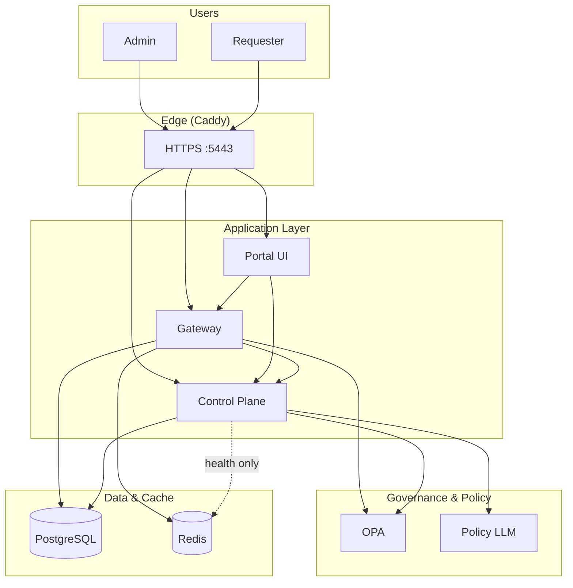
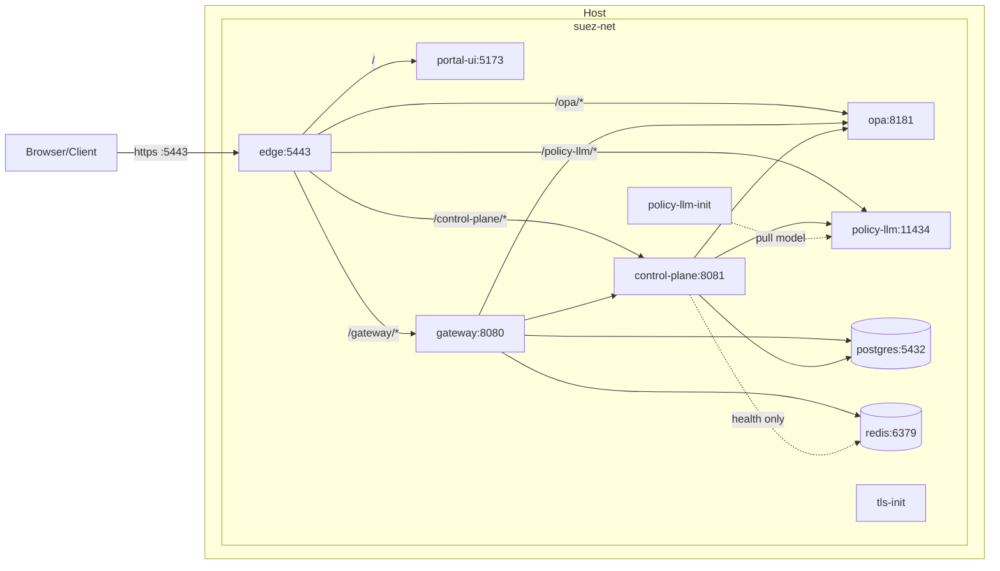
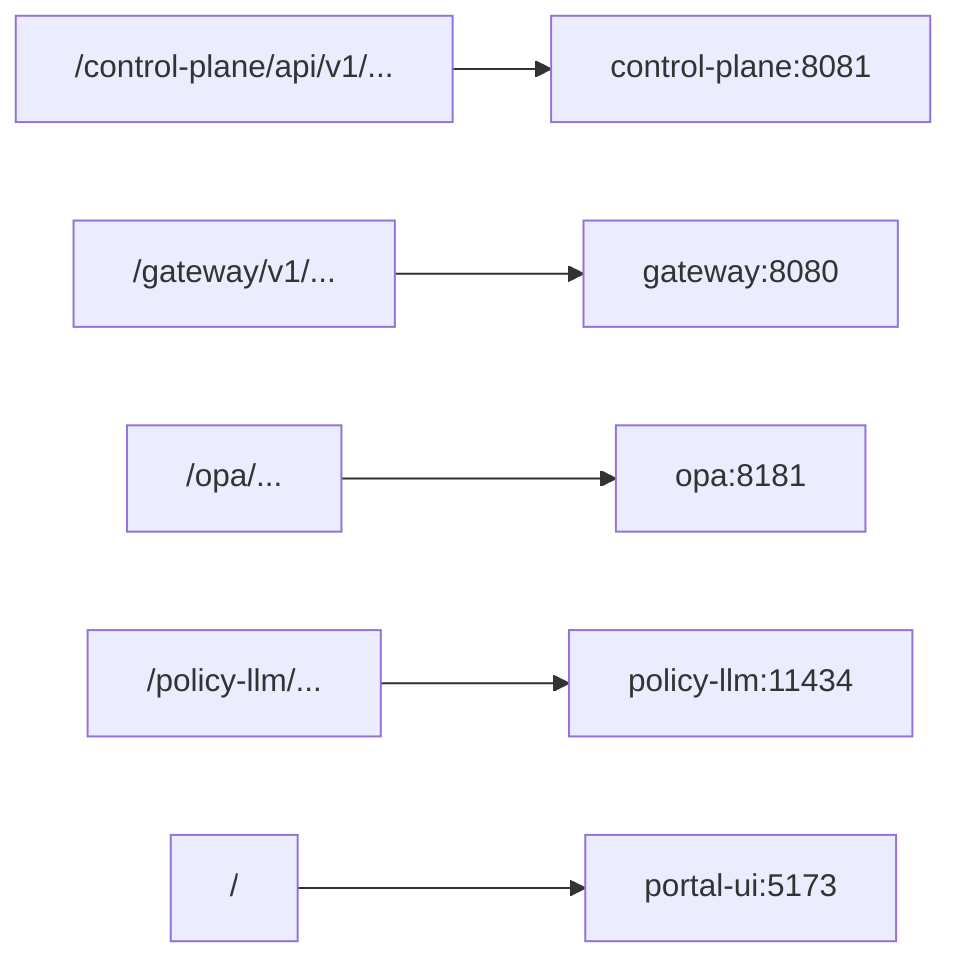
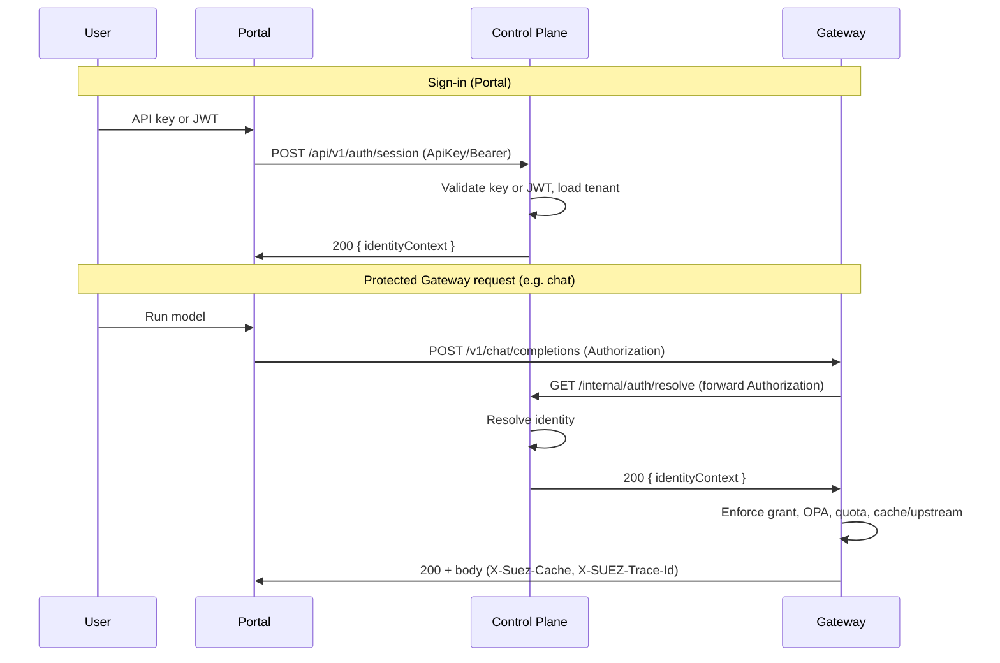
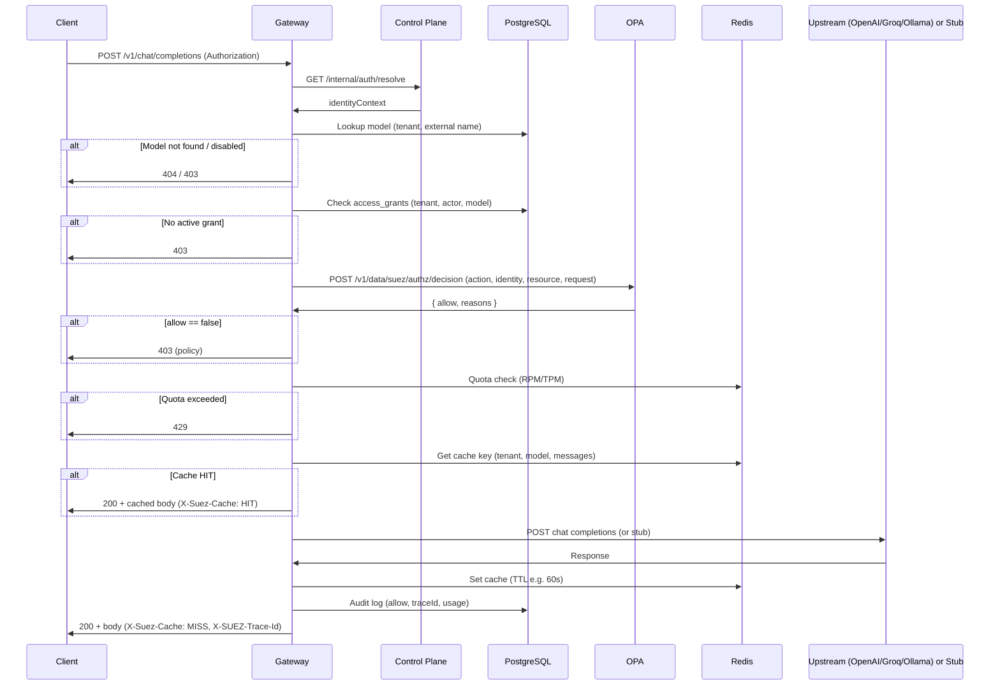
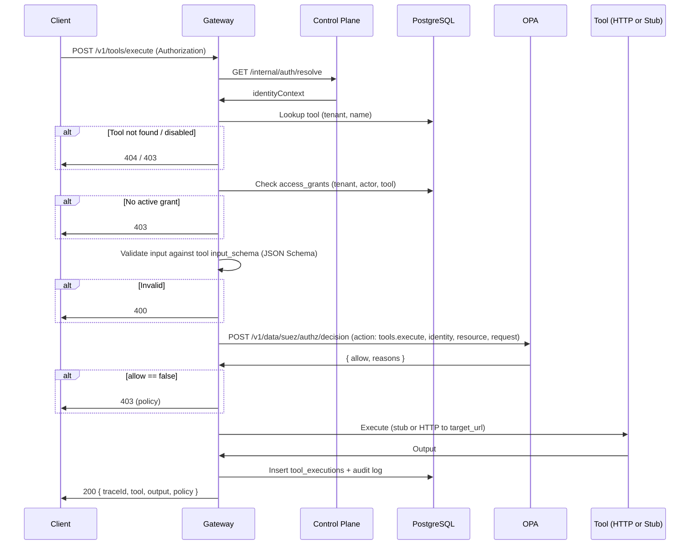
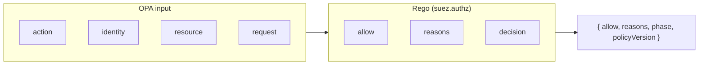
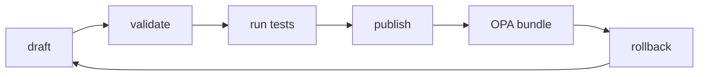
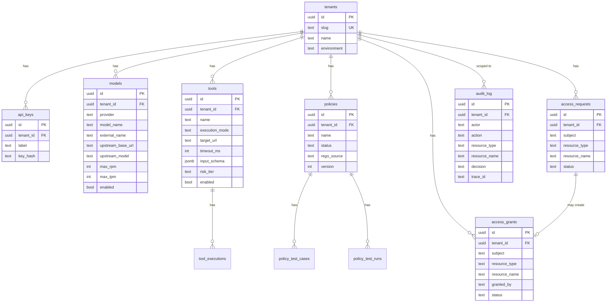

# SUEZ Gateway: Architecture Document

This document describes the architecture of Suez, a local-first AI governance gateway. It covers system components, deployment topology, request flows, authentication, policy enforcement, and data models. Diagrams use [Mermaid](https://mermaid.js.org/) and render in Markdown viewers that support it (e.g. GitHub, GitLab, VS Code).

---

## 1. Overview

Suez provides:

- **Governed access** to AI models and tools via a single gateway (approvals, grants, quotas).
- **Policy-driven authorization** using Open Policy Agent (OPA) with optional natural-language policy drafting via an **open source LLM** (policy-llm / Ollama).
- **Unified portal** for admins (catalog, access, governance, setup, observability) and requesters (requests, grants, model/tool invocation).
- **Audit and observability** (audit log, trace drill-down, cache and request metrics).

The runtime is **Docker Compose** for local development; the design is aligned with a future Kubernetes deployment.

---

## 2. High-Level Architecture

**Responsibilities:**

| Component | Role |
|-----------|------|
| **Portal UI** | React SPA: landing, sign-in (API key / JWT), Admin and Requester panels. Calls Control Plane and Gateway APIs. |
| **Control Plane** | Config and governance API: tenants, API keys, access requests/grants, catalog (models, tools), policy lifecycle (draft, test, publish, rollback), audit log. Resolves identity for Gateway. |
| **Gateway** | Runtime enforcement: identity resolution via Control Plane, grant checks, OPA evaluation, quotas (Redis), response cache (Redis), chat completions and tool execution, audit events. |
| **OPA** | Policy engine: evaluates allow/deny and reasons for `chat.completions` and `tools.execute` using Rego. |
| **Policy LLM** | **Open source LLM** (Ollama, e.g. qwen2.5-coder) for natural-language policy draft generation (used by Control Plane). |
| **PostgreSQL** | Persistent store: tenants, API keys, models, tools, access requests/grants, policies, policy tests, audit log, tool executions. |
| **Redis** | **Gateway:** quota counters, chat response cache, request/cache hit stats. **Control plane:** only a TCP health check in Compose (no application data in Redis). |

---

## 3. Deployment Topology (Docker Compose)

All services run on a single bridge network `suez-net`. The edge terminates TLS and routes by path.

**Startup order (simplified):** Postgres, Redis, OPA, policy-llm → policy-llm-init (must complete) → control-plane → gateway and portal-ui in parallel → **edge** starts after **tls-init** has finished writing certs and the backends above are healthy.

**Ports (defaults):** 5432 (Postgres), 6379 (Redis), 8181 (OPA), 11434 (policy-llm), 8081 (control-plane), 8080 (gateway), 5173 (portal-ui), 5443 (edge HTTPS).

---

## 4. Request Routing (Edge)

The Caddy edge strips the path prefix and proxies to the correct backend.

- **Portal** is built with `VITE_CONTROL_PLANE_URL` and `VITE_GATEWAY_URL` pointing at the edge (e.g. `https://host:5443/control-plane`, `https://host:5443/gateway`) so the browser talks to the same origin for API calls. The Caddy `handle_path` directives strip `/control-plane`, `/gateway`, `/opa`, and `/policy-llm` before forwarding, so backends see their normal paths (for example `/api/v1/...` on the control plane and `/v1/...` on the gateway).
- **Direct HTTP** (e.g. portal on 5173, control-plane on 8081, gateway on 8080) is still available for local debugging; defaults omit the edge path prefix.

---

## 5. Authentication and Identity Resolution

Portal sign-in uses **API key** or **JWT**. The Control Plane validates the credential and returns an **identity context** (tenant, actor, roles, etc.). The Gateway does not validate credentials itself; for each protected request it calls the Control Plane **internal** auth-resolve endpoint to turn `Authorization` or `X-API-Key` into the same identity context.

**Identity context** fields include: `tenantId`, `tenantSlug`, `tenantName`, `actor`, `authMethod`, `apiKeyId` or `jwtSubject`, `roles`, `authenticatedAt`, and optional `claims`/`metadata`. The Gateway uses this for grant lookups (tenant + actor), OPA input, quota keys, and audit.

---

## 6. Chat Completion Flow (Gateway)

End-to-end flow for `POST /v1/chat/completions`:

**Model providers:** stub (in-process), openai-compatible (configurable base URL + API key), groq (configurable base URL + API key). Provider and upstream config come from the `models` table.

---

## 7. Tool Execution Flow (Gateway)

Flow for `POST /v1/tools/execute`:

Tools are configured with `execution_mode` (e.g. stub, http) and optional `target_url`, `timeout_ms`, and `http_headers`.

---

## 8. Policy and Governance

### 8.1 OPA Decision Model

OPA is called with an **input** object; the policy returns **allow** and **reasons**.

- **Actions:** `chat.completions`, `tools.execute`.
- **Identity:** tenantId, actor, roles, etc. (from Control Plane).
- **Resource:** model or tool metadata (type, name, enabled, riskTier, etc.).
- **Request:** payload (e.g. messages for chat, tool input for tools).

Base rules (e.g. in `phase0.rego`) enforce: supported action, identity present, resource enabled, resource shape valid; high-risk tools can require admin role unless a published policy applies. Published policy results (from Control Plane–pushed bundles) can override or extend this.

### 8.2 Policy Lifecycle (Control Plane)

Admins manage policies in the portal: create drafts, optionally **generate** Rego from natural language via **Policy LLM**, **validate**, add **policy test cases**, **run tests**, then **publish** to OPA. **Rollback** restores a previous published version.

Policy LLM (open source LLM via Ollama) is used at **generate** time; OPA evaluates at **runtime** in the Gateway.

---

## 9. Data Model (Core Entities)

PostgreSQL holds configuration and audit data. Simplified entity relationship:

**Gateway** uses Redis for:

- **Quotas:** `quota:{tenantId}:{actor}:{resourceName}:{YYYYMMDDHHMM}:rpm` and the same prefix with `:tpm` (minute bucket in UTC, `200601021504` format).
- **Chat cache:** `suez:chat:` + SHA-256 hex digest of tenant id, model, and serialized `messages` JSON; TTL 60s.
- **Stats:** `suez:stats:chat_requests`, `suez:stats:cache_hits`.

The **control plane** does not read or write Redis for application state; Compose still requires Redis to be reachable so `/healthz` passes.

---

## 10. Control Plane API Surface

The Control Plane exposes REST APIs used by the Portal (and internally by the Gateway for auth resolve). All authenticated routes expect identity from `withIdentity` middleware (API key or JWT).

```mermaid
flowchart TB
    subgraph Public
        Bootstrap["/api/v1/bootstrap/status"]
    end

    subgraph Internal
        AuthResolve["/internal/auth/resolve"]
    end

    subgraph Authenticated["/api/v1/* (with identity)"]
        AuthSession["/api/v1/auth/session"]
        Tenants["/api/v1/tenants"]
        APIKeys["/api/v1/api-keys"]
        AccessRequests["/api/v1/access-requests"]
        AccessGrants["/api/v1/access-grants"]
        Models["/api/v1/models"]
        Tools["/api/v1/tools"]
        Policies["/api/v1/policies"]
        PolicyGenerate["/api/v1/policies/generate"]
        PolicyActions["/api/v1/policies/{id}/*"]
        AuditLog["/api/v1/audit-log"]
        AuditTrace["/api/v1/audit-log/traces/{id}"]
    end

    Portal --> Bootstrap
    Portal --> AuthSession
    Portal --> Tenants
    Portal --> APIKeys
    Portal --> AccessRequests
    Portal --> AccessGrants
    Portal --> Models
    Portal --> Tools
    Portal --> Policies
    Portal --> PolicyGenerate
    Portal --> PolicyActions
    Portal --> AuditLog
    Portal --> AuditTrace
    GW[Gateway] --> AuthResolve
```

---

## 11. Gateway API Surface

| Method | Path | Auth | Description |
|--------|------|------|-------------|
| GET | `/` | No | Service info and routes |
| GET | `/healthz` | No | Health and dependency checks |
| GET | `/v1/identity` | Yes | Return resolved identity context |
| POST | `/v1/chat/completions` | Yes | OpenAI-style chat completion (grant, OPA, quota, cache, upstream) |
| POST | `/v1/tools/execute` | Yes | Execute a tool by name with JSON input |
| GET | `/v1/observability` | Yes | Cache entries, cache hits, chat request count (from Redis) |
| GET | `/v1/context/usage?session=<id>` | Yes | Latest context-usage measurement for the caller's own session (used by SUEZ Context Guardian). Requires migration `0006`; see [ARCHITECTURE.md](ARCHITECTURE.md). |

All protected routes go through **identity resolution** (Control Plane `/internal/auth/resolve`).

---

## 12. Component Summary

| Layer | Component | Tech | Purpose |
|-------|-----------|------|---------|
| Front | Portal UI | React, TypeScript, Vite | Admin and Requester UI; calls Control Plane and Gateway |
| API | Control Plane | Go, net/http, pgx | Config, access workflow, policy lifecycle, audit, identity resolution |
| API | Gateway | Go, net/http, pgx, go-redis | Enforcement: identity, grants, OPA, quota, cache, chat/tools |
| Policy | OPA | Rego | Authorization decisions for chat and tool execution |
| Policy | Policy LLM | Open source LLM (Ollama) | Natural-language policy draft generation |
| Data | PostgreSQL | Postgres 16 | Tenants, catalog, access, policies, audit |
| Data | Redis | Redis 7 | Quotas, response cache, gateway stats |
| Edge | Caddy | Caddy 2 | HTTPS termination and path-based routing |

For operational and troubleshooting details, see **docs/operations.md** and **docs/TROUBLESHOOTING.md**. For local setup and commands, see **docs/local-development.md**. For enterprise SaaS on AWS (EKS, multi-tenancy, SSO), see **docs/saas/enterprise-saas-aws.md** and related files in **docs/saas/**.
