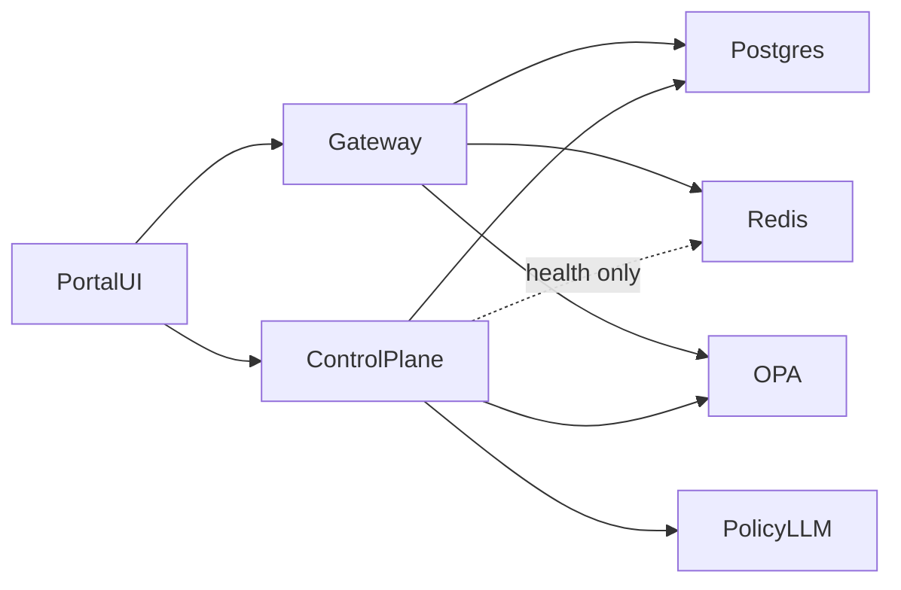

# Local Architecture

Phase 8 uses Docker Compose as the local runtime while keeping the codebase aligned with the longer-term Kubernetes target.

## Services

- `gateway`: enforced AI traffic entry point for governed model and tool execution.
- `control-plane`: configuration, audit, policy test, publish, version, and rollback API.
- `portal-ui`: React + TypeScript frontend for admin and requester workflows.
- `postgres`: local config, policy lifecycle, policy test, and audit store.
- `redis`: quotas, chat cache, and gateway stats; control plane only checks TCP connectivity for `/healthz` (no Redis application state in the control plane).
- `opa`: local policy engine for live authorization decisions.
- `policy-llm`: local **open source LLM** (Ollama) for natural-language policy drafting.
- `policy-llm-init`: one-shot pull of the pinned policy model into Ollama.
- `tls-init`: generates self-signed TLS material for the edge when missing (see `infra/tls/`).
- `edge` (Caddy): HTTPS reverse proxy; path prefixes `/control-plane`, `/gateway`, `/opa`, `/policy-llm` map to backends (see `infra/tls/Caddyfile`).

## Request Flow

## Local Runtime Notes

- Docker Compose is the source of truth for local development.
- PostgreSQL bootstrap scripts initialize schema and seed data on first startup.
- OPA loads the base bundle from disk and receives published policy modules from the control-plane.
- An open source LLM (Ollama with a pinned model, e.g. qwen2.5-coder) is used so policy draft generation produces real Rego output.
- A local HTTPS edge terminates a self-signed certificate and proxies the portal plus API routes.
- Sensitive provider credentials can be supplied through `.env` or file-backed secrets under `infra/secrets/`.
