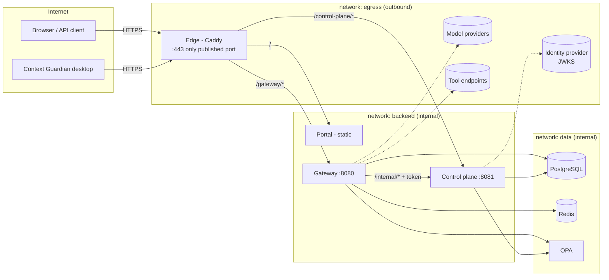
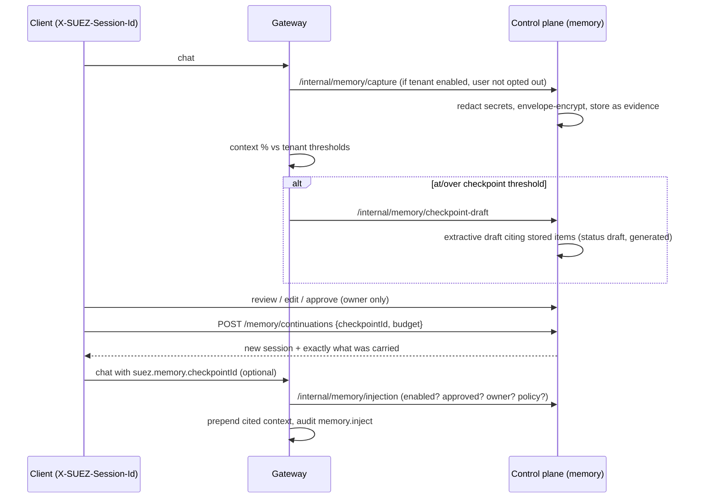

# Production architecture

## Components and network exposure

Only the edge publishes a port. `data` and `backend` are `internal: true`
Docker networks: no inbound route from the host network and no outbound
route to the internet. The edge refuses `/internal*`, `/opa*` and
`/policy-llm*`.

## Request flow (chat)

1. Edge terminates TLS and forwards `/gateway/*`.
2. Gateway asks the control plane (`/internal/auth/resolve`, internal token) who the caller is. API keys are looked up by hash; JWTs are verified and bound to a `users` row. Failure of the resolver → 503, never an identity.
3. Gateway checks the route's permission (`gateway.invoke`), the key's model allowlist and per-key rate limit.
4. Model lookup, active grant, OPA decision (`chat.completions`).
5. Context check on a conservative estimate; optional hard block (409 + checkpoint draft).
6. Quota reservation in Redis (atomic INCR+EXPIRE, fails closed).
7. Cache lookup (see below), else provider call with safe retries; streaming relays chunks.
8. Accounting: quota reconciliation with real usage, audit record (no prompt content), usage measurement, memory capture (if enabled), threshold checkpoint draft.

## OPA isolation

- Base policy `suez.authz` (`infra/opa/policies/suez/phase0.rego`) holds identity, resource and high-risk checks.
- A published tenant policy is loaded as module `suez/generated/<policy id>` with package `suez.generated.t_<tenant>.p_<policy>` (dashes → underscores). The control plane rewrites only the first statement, which must be exactly `package suez.authz`, then reads back the package OPA parsed and deletes the module if it differs.
- The base policy reads `data.suez.generated[t_<caller tenant>][_].published_policy_results` and nothing else from tenant code.
- Validation and test runs load drafts as `suez/sandbox/<random>`; the base policy consults sandboxes only when `input.sandbox` is set, which only the control plane does.
- Publish, rollback and sync take a PostgreSQL advisory lock (`pg_advisory_lock`), so replicas sharing a database serialize. Sync writes desired modules before deleting stale ones. A reconciler re-applies the published set every 30 s, which repairs an OPA that restarted empty.

## Cache

- Redis key `suez:chat:<tenant>:<sha256>`; the digest covers the tenant's published-policy stamp, model, every message (all roles), sampling options, tools, tool choice, response format and stop sequences. Unset and zero options differ. Streaming does not change the key.
- Only successful, validated responses are written; TTL 60 s. Requests with memory injection are never cached.
- Hits and misses are both audited.

## SUEZ Memory and checkpoints

- Data model: `memory_workspaces` → `memory_workflows` → `memory_sessions` → `memory_items` (message, event, tool_result, observation, artifact, summary), `memory_checkpoints`, `memory_sources` (what a summary or checkpoint cites), `memory_retrievals` (every read above the index).
- Every item has tenant, actor, timestamp, provenance (trace id, model, recorder), sensitivity, expiry and deletion state. `origin = generated` marks AI-written text; summaries require stored sources and checkpoints may only cite non-generated items.
- Progressive retrieval: session index/search (previews only) → timeline (previews) → item detail (content), each permission-checked and recorded.
- Content is encrypted per item with a random data key wrapped by the configured key provider (AES-256-GCM, row-bound additional data). The shipped provider keeps the key-encryption key in `SUEZ_DATA_KEY`; the `keyProvider` interface in `crypto.go` is the seam for a KMS.

## Context Guardian

The desktop app reads usage, tenant thresholds and context status from
`GET /v1/context/usage`, and uses `/v1/memory/*` through the gateway (with
its own key) to list, upload, review and continue from server checkpoints.
Local checkpoint files remain a private working copy; the server is the
shared record. The key lives in the OS keychain and is only used by Rust.
