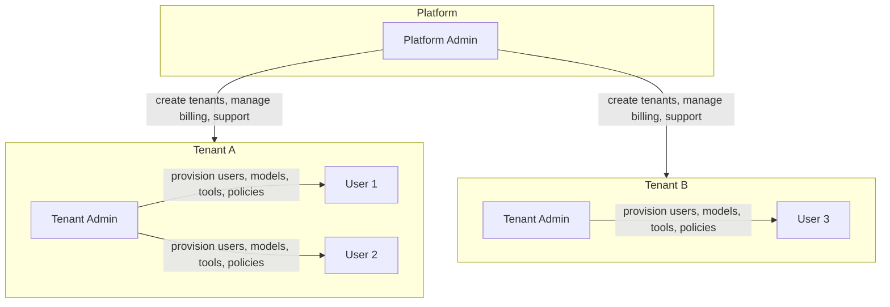
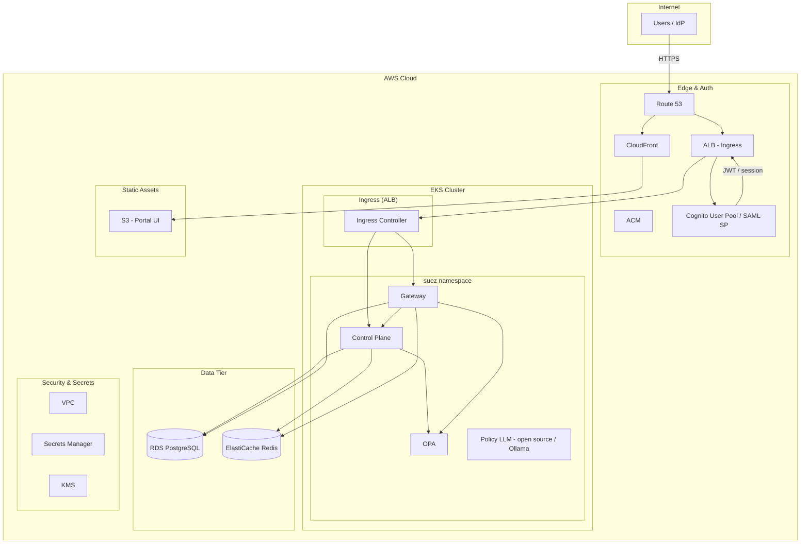
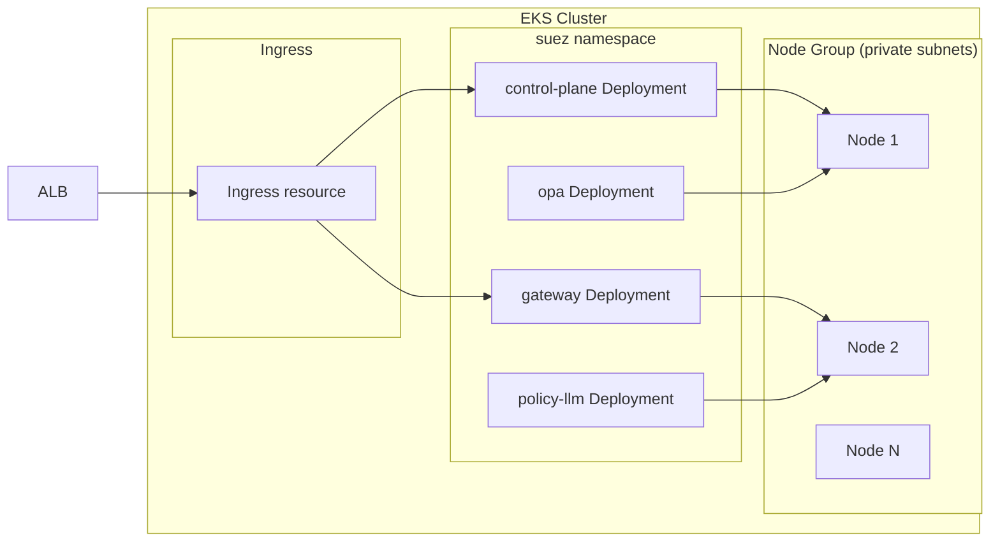
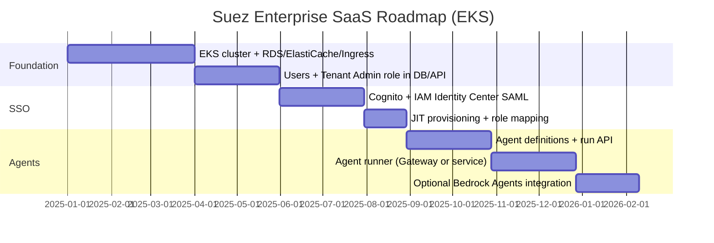

# Suez Enterprise SaaS on AWS: Architecture and Roadmap

This document outlines the architecture and roadmap to evolve Suez from a local-first AI governance gateway into an **enterprise-grade Software-as-a-Service (SaaS)** hosted on **AWS**, with **multi-tenancy**, **tenant-scoped admins and users**, **SAML SSO** (integrating with AWS IAM Identity Center and related products), and **AI Agents** support.

---

## 1. Vision and Goals

| Goal | Description |
|------|-------------|
| **Enterprise SaaS** | Single deployment on AWS serving multiple customer organizations (tenants) with high availability, security, and scalability. |
| **Multi-tenancy** | Each **tenant** is an isolated customer org. Tenant data (users, models, tools, policies, audit) is scoped by `tenant_id`. |
| **Tenant Admin + Users** | Each tenant has **Tenant Admins** (provision users and models for the tenant) and **Users** (consume models/tools/agents within the tenant). |
| **SAML SSO** | Integrate with **AWS IAM Identity Center** (and optionally other SAML IdPs) so enterprises can sign in with existing corporate identity. |
| **AI Agents** | Support **AI Agents**: defined workflows that combine models, tools, and optional orchestration (e.g., Bedrock Agents, custom runners) with governance applied at the gateway. |

---

## 2. Multi-Tenancy and Roles

### 2.1 Role Hierarchy



| Role | Scope | Capabilities |
|------|--------|--------------|
| **Platform Admin** | Global | Create/suspend tenants, manage platform config, support tooling, billing. Not tenant-scoped. |
| **Tenant Admin** | Single tenant | Provision users (invite, disable), manage API keys, register models and tools, manage access and policies, view tenant audit. |
| **User** (tenant user) | Single tenant | Request access to models/tools, use granted models/tools, run agents (when enabled). |

### 2.2 Current vs Target Identity Model

**Current:** Identity is derived from **API key** (linked to tenant via `api_keys.tenant_id`) or **JWT** (tenant and roles in claims). There is no first-class **users** table; “subject” in access_requests/grants is a string (e.g. email).

**Target:**

- **Users** table: `tenant_id`, `email`, `name`, `role` (`tenant_admin` | `user`), `saml_subject_id` (for SSO), `status`, `created_at`, `updated_at`.
- **Tenant Admins** are users with `role = 'tenant_admin'`; they can manage only their tenant’s users and catalog.
- **Platform Admins** are either a separate store (e.g. platform_admins table or IAM Identity Center group) and are not scoped by tenant.
- **API keys** remain per-tenant and can be tied to a user (e.g. `user_id` FK) for audit.
- **Access requests/grants** continue to use a **subject** that can be the user’s `id` or a stable `email`/`saml_subject_id` for consistency with existing OPA and gateway logic.

---

## 3. AWS Hosting Architecture (EKS-Based)

The SaaS platform runs on **Amazon EKS** (Kubernetes). All application workloads are deployed as Kubernetes Deployments and Services; traffic enters via an **Application Load Balancer** (ALB) using the **AWS Load Balancer Controller** (Ingress). Static assets are served from **S3** and **CloudFront**; API and auth flows go through the ALB to the EKS cluster.

### 3.1 High-Level Architecture



### 3.2 EKS Cluster Topology



- **Node groups**: EKS managed node groups (or Karpenter for autoscaling) in **private subnets**; nodes need NAT Gateway or NAT instances for outbound (RDS, ElastiCache, Secrets Manager, upstream APIs).
- **Namespaces**: Application workloads run in a dedicated namespace (e.g. `suez`); optional separate namespaces for ingress or observability.
- **Ingress**: Kubernetes **Ingress** resource with **AWS Load Balancer Controller**; creates an **ALB** and Target Groups pointing at Control Plane and Gateway **Services**. TLS termination at ALB using **ACM**; host/path rules route traffic to each service (today’s local Compose edge uses path prefixes **`/control-plane`**, **`/gateway`**, **`/opa`**, **`/policy-llm`** on Caddy; the SaaS Ingress should mirror those paths or terminate on hostnames per service).
- **Portal**: Build output (e.g. from CI) is uploaded to **S3** and served via **CloudFront** with the same domain (e.g. `suez.acrosystems.ai`) or a path; API requests go to the ALB (same origin or CORS).

### 3.3 Component Mapping (EKS)

| Current (Compose) | AWS SaaS (EKS) |
|-------------------|----------------|
| Edge (Caddy on :5443) | **ALB** + Ingress (or equivalent); TLS via **ACM**; path- or host-based routes to portal, control plane, gateway, OPA, policy LLM. |
| Portal UI | Static assets in **S3**, served via **CloudFront**; API calls to ALB (Ingress). |
| Control Plane | **Kubernetes Deployment** in EKS; **Service** (ClusterIP); env and secrets from **Secrets Manager** (e.g. External Secrets Operator or Secrets Store CSI driver) or **ConfigMaps**; scale via **HPA** or Karpenter. |
| Gateway | **Kubernetes Deployment** in EKS; **Service** (ClusterIP); same secrets pattern; scale with **HPA** based on CPU or RPS. |
| OPA | **Kubernetes Deployment** in EKS; policy bundle loaded from **S3** or pushed by Control Plane; optional **Init Container** to fetch bundle. |
| Policy LLM | **Open source LLM** via **Ollama** Deployment in EKS (e.g. `qwen2.5-coder` or similar); no proprietary/cloud LLM required for policy drafting. |
| PostgreSQL | **RDS PostgreSQL** (multi-AZ) in private subnets; EKS pods reach it via VPC; credentials in Secrets Manager, mounted or injected via External Secrets. |
| Redis | **ElastiCache for Redis** (cluster mode if needed) in private subnets; EKS pods reach it via VPC. |

### 3.4 Network and Security (EKS)

- **VPC**: Private subnets for EKS node groups, RDS, and ElastiCache; public subnets for ALB and NAT Gateway. EKS cluster endpoint can be private (recommended) or public with restricted access.
- **EKS**: Private node groups; **IRSA** (IAM Roles for Service Accounts) so Control Plane and Gateway pods assume IAM roles for Secrets Manager (and optionally S3) without embedding keys. Policy drafting uses an **open source LLM** (Ollama in-cluster), not Bedrock.
- **ALB**: Created by AWS Load Balancer Controller from Ingress; TLS (ACM); path-based or host-based routing; optional **WAF** attached to ALB.
- **Secrets**: **Secrets Manager** holds DB credentials, third-party API keys, SAML certs; sync into Kubernetes **Secrets** via **External Secrets Operator** or **Secrets Store CSI driver** so pods get env or volume mounts; encryption with **KMS**.
- **Tenant data isolation**: Enforce `tenant_id` in all application queries; optional **Row-Level Security (RLS)** in PostgreSQL. No cross-tenant access except Platform Admin tooling.

### 3.5 Deployment and Tenancy Strategy

- **Single shared database** with `tenant_id` on every tenant-scoped table (current pattern); RLS in PostgreSQL can enforce tenant isolation at the DB layer.
- **Schema-per-tenant** is an alternative for stronger isolation at the cost of operational and migration complexity; not required for MVP.
- **Caching and quotas**: Redis keys already include `tenant_id` (e.g. quota, cache keys); ensure no key crosses tenants.

### 3.6 EKS Operations and Tooling

- **Provisioning**: EKS cluster and node groups via **Terraform**, **CloudFormation**, or **EKS Blueprints**; **AWS Load Balancer Controller** and **EBS CSI driver** installed as add-ons or Helm charts.
- **Deployments**: Application manifests (Deployments, Services, Ingress, ConfigMaps) managed with **Kustomize** or **Helm**; CI/CD (e.g. GitOps with Argo CD or Flux) applies to the `suez` namespace.
- **Secrets**: **External Secrets Operator** or **Secrets Store CSI driver** syncs from Secrets Manager into Kubernetes Secrets; pods reference them via env or volumes.
- **IAM**: **IRSA** (IAM Roles for Service Accounts) grants Control Plane and Gateway pods least-privilege access to Secrets Manager and S3 (policy bundle). Policy LLM is open source (Ollama); no Bedrock access needed for policy.
- **Observability**: Container logs to **CloudWatch Logs** (Fluent Bit or DaemonSet); metrics from **Prometheus** and/or **CloudWatch Container Insights**; tracing optional (X-Ray, Otel).

---

## 4. SAML SSO with AWS

### 4.1 Target Flow: IAM Identity Center → Cognito → Suez

Use **AWS IAM Identity Center** (successor to AWS SSO) as the enterprise IdP and **Amazon Cognito** as the SAML Service Provider (SP) so the app receives OIDC/JWT tokens and does not implement SAML parsing itself.

```mermaid
sequenceDiagram
    participant User
    participant IdP as IAM Identity Center (IdP)
    participant Cognito as Cognito User Pool (SP)
    participant App as Suez Portal / Control Plane

    User->>App: Access Suez (e.g. https://suez.acrosystems.ai)
    App->>User: Redirect to Cognito Hosted UI
    User->>Cognito: Cognito login (or direct IdP link)
    Cognito->>IdP: SAML Request (SP-initiated)
    IdP->>User: Enterprise login (corporate credentials)
    User->>IdP: Credentials
    IdP->>Cognito: SAML Response (assertion with attributes)
    Cognito->>Cognito: Map SAML attributes to user; create/update user
    Cognito->>User: Redirect to App with auth code
    User->>App: Callback with code
    App->>Cognito: Exchange code for JWT (id_token, access_token)
    App->>App: Resolve tenant + role from token attributes
    App->>Control Plane: API calls with JWT (Bearer)
    Control Plane->>Control Plane: Validate JWT; load tenant + user; enforce role
```

### 4.2 AWS-Side Configuration (Summary)

1. **IAM Identity Center**
   - Create a **custom SAML 2.0 application**.
   - Configure **ACS URL** and **audience** to point to Cognito’s SAML endpoint.
   - **Attribute mapping**: map `email`, `name`, and a **tenant identifier** (e.g. custom attribute or group) to SAML assertion attributes. Map **roles** (e.g. `tenant_admin`, `user`) via group membership or attributes.
   - Assign users/groups to the application so they can SSO into the app.

2. **Cognito**
   - Create a **User Pool** with **SAML** as an identity provider; metadata from IAM Identity Center.
   - Configure **attribute mapping** from SAML attributes to Cognito user attributes (and custom attributes for `tenant_id`, `tenant_role` if needed).
   - App uses **Authorization Code** or **Hosted UI**; after login, Cognito issues **JWT** (id_token / access_token). App validates JWT and passes it to Control Plane.

3. **Suez Application**
   - **Portal**: Redirect unauthenticated users to Cognito Hosted UI (or use Amplify JS SDK). On callback, store tokens and pass **Bearer JWT** to Control Plane and Gateway.
   - **Control Plane**: Validates JWT (signature, issuer, audience), extracts `sub`, custom claims (`tenant_id` or `tenant_slug`, `role`), and builds **identity context** (same shape as today). If user record does not exist, **just-in-time (JIT) provisioning**: create user and optionally tenant from SAML attributes (or deny if tenant not pre-provisioned).
   - **Gateway**: Unchanged: calls Control Plane **internal auth/resolve** with `Authorization: Bearer <JWT>`. Control Plane resolves JWT to identity context and returns it; Gateway enforces grants/OPA as today.

### 4.3 Hybrid: API Keys and SSO

- **Tenant Admins** and **Users** can sign in via **SAML SSO** (Cognito JWT).
- **Programmatic access** (CI/CD, integrations) continues to use **API keys** (created by Tenant Admin, optionally bound to a user). Control Plane validates API key and returns identity context with tenant and actor (e.g. user id or key label).
- Support both **Authorization: Bearer <JWT>** and **Authorization: ApiKey <key>** (and optionally **X-API-Key**) in the same APIs.

---

## 5. Data Model Evolution

### 5.1 New and Changed Objects

- **users**  
  - `id`, `tenant_id` (FK), `email`, `name`, `role` (`tenant_admin` | `user`), `saml_subject_id` (nullable), `status`, `invited_at`, `last_login_at`, `created_at`, `updated_at`.  
  - Unique on `(tenant_id, email)`; unique on `saml_subject_id` when not null.

- **tenant_admins** (optional)  
  - If you prefer not to encode admin in `users.role`, use a separate table: `tenant_id`, `user_id`, `granted_by`, `created_at`.

- **api_keys**  
  - Add optional `user_id` (FK to users) for “created by” and audit. Existing behavior (tenant-scoped key with no user) remains for backward compatibility.

- **tenants**  
  - Add optional `saml_tenant_attr` (e.g. attribute name or value used in SAML to assign users to this tenant), `sso_domain`, `status` (`active` | `suspended`).

- **access_requests / access_grants**  
  - Keep `subject` as a string; recommend storing a stable user identifier (e.g. `users.id` or `email`) so Tenant Admin can map requests to users. No schema change required if you keep using email or user id as subject.

### 5.2 AI Agents (New)

- **agents**  
  - `id`, `tenant_id`, `name`, `description`, `definition` (JSON: model ref, tools, prompt template, orchestration type), `status` (`active` | `draft`), `created_at`, `updated_at`.

- **agent_runs** (or **agent_sessions**)  
  - `id`, `tenant_id`, `agent_id`, `user_id` (or actor string), `status`, `input_summary`, `output_summary`, `trace_id`, `started_at`, `finished_at`, `metadata` (JSON).

- **agent_tool_calls** (optional, for audit)  
  - `id`, `agent_run_id`, `tool_name`, `input`, `output`, `created_at`.

Agents can be implemented as:
- **Custom runner** in the Gateway (or a new Agent service): load agent definition, call model + tools in a loop (ReAct or custom), enforce OPA and grants per tool/model call.
- **Integration with Amazon Bedrock Agents**: Gateway delegates to Bedrock for orchestration; Gateway still enforces tenant identity, audit, and optional policy checks at the boundary.

---

## 6. AI Agents: Product and Technical Outline

### 6.1 Capabilities

- **Tenant-scoped agent definitions**: Tenant Admin creates agents that specify model(s), tools, and high-level behavior (e.g. system prompt, max steps).
- **Execution through gateway**: All model and tool calls go through the existing Gateway so that governance (grants, OPA, quotas, audit) applies.
- **Orchestration**: Either in-process (Gateway or dedicated Agent service) or via **Bedrock Agents**; in both cases the Gateway (or a thin Agent API in front of it) authenticates the tenant user and records agent runs.

### 6.2 High-Level Agent Flow

```mermaid
sequenceDiagram
    participant User
    participant Portal
    participant API as Control Plane / Agent API
    participant GW as Gateway
    participant Model
    participant Tools

    User->>Portal: Run agent (e.g. "Answer with tools")
    Portal->>API: POST /api/v1/agents/{id}/run (JWT)
    API->>API: Resolve identity; load agent definition
    API->>GW: Chat completion (model + messages)
    GW->>Model: Request
    Model->>GW: Response (e.g. tool_calls)
    loop Tool use
        API->>GW: Tool execute (per tool call)
        GW->>Tools: Execute
        Tools->>GW: Result
        GW->>API: Result
        API->>GW: Chat completion (tool results)
        GW->>Model: Request
        Model->>GW: Response
    end
    API->>API: Persist agent_run; audit
    API->>Portal: 200 + agent output
```

### 6.3 API Surface (Suggested)

- **Control Plane (or Agent service)**  
  - `GET /api/v1/agents` – list agents (tenant-scoped).  
  - `POST /api/v1/agents` – create agent (Tenant Admin).  
  - `GET /api/v1/agents/:id` – get definition.  
  - `PUT /api/v1/agents/:id` – update (Tenant Admin).  
  - `POST /api/v1/agents/:id/run` – execute agent (identity from JWT/API key; Gateway used for each model/tool call).

- **Gateway**  
  - Existing `POST /v1/chat/completions` and `POST /v1/tools/execute` are reused by the agent runner. Optional: `POST /v1/agents/run` that accepts an agent id and runs the loop server-side (same governance).

---

## 7. Phased Roadmap



| Phase | Scope | Deliverables |
|-------|--------|--------------|
| **1. Foundation** | EKS hosting + explicit users and tenant admin | EKS cluster, node groups, RDS, ElastiCache, ALB Ingress (AWS Load Balancer Controller), Secrets Manager (and External Secrets or CSI); `users` table and migrations; Control Plane, Gateway, OPA as Deployments; Tenant Admin can CRUD users and assign models; Platform Admin can create/suspend tenants. Portal and API enforce roles. |
| **2. SAML SSO** | Enterprise SSO with AWS | Cognito User Pool with SAML IdP (IAM Identity Center); attribute mapping for tenant and role; JIT user (and optional tenant) provisioning; Portal login via Cognito Hosted UI; Control Plane accepts Bearer JWT and resolves identity. |
| **3. AI Agents** | Agent definitions and execution | `agents` and `agent_runs` tables; Control Plane (or Agent) API for CRUD and run; agent runner that uses existing Gateway for model/tool calls; audit and observability for runs. Optional: Bedrock Agents integration for orchestration. |

---

## 8. Summary

- **Multi-tenancy** is preserved and extended with a **users** table and **Tenant Admin** vs **User** roles; **Platform Admin** operates across tenants.
- **AWS hosting** is **EKS-based**: application workloads (Control Plane, Gateway, OPA, optional Policy LLM) run as Kubernetes Deployments and Services; traffic enters via **ALB** and **Ingress** (AWS Load Balancer Controller); **RDS**, **ElastiCache**, **S3**, **CloudFront**, **Cognito**, and **Secrets Manager** complete the stack.
- **SAML SSO** is achieved by using **AWS IAM Identity Center** as the IdP and **Cognito** as the SAML SP; the app uses **Cognito JWT** and does not parse SAML directly; **API keys** remain for programmatic access.
- **AI Agents** are tenant-scoped definitions executed via the existing **Gateway** (and optional Bedrock Agents), with full governance and audit.

This document can be used as the master reference for implementation. **implementation-plan-aws.md** in this directory provides a detailed, step-by-step implementation plan from a blank AWS account (VPC, EKS, RDS, ElastiCache, secrets, workloads, Ingress, Portal, validation, and optional SSO). Next steps are to break Phase 1 into concrete tasks (migrations, API changes, and UI for user and tenant admin management) and to align SAML attribute design with IAM Identity Center and Cognito configuration.
