# Suez on AWS: Detailed Implementation Plan

This document is a **step-by-step implementation plan** for deploying Suez as an enterprise SaaS on AWS. Deployment is performed by an **IAM user `suez`** (in group **`suezgateway`**). **You** provide access keys for both **Admin** and **suez**; all actions use a **`.env`** file so that the same environment drives Admin (one-time IAM setup) and operator (stack deployment) steps. The plan assumes the target architecture in **enterprise-saas-aws.md** (in this directory). The application domain is **suez.acrosystems.ai**; the TLS certificate is an **AWS-generated certificate** (ACM) for that domain.

**Local vs AWS:** The same services (control plane, gateway, OPA, policy LLM, portal) and HTTP paths (`/api/v1/...` on the control plane, `/v1/...` on the gateway) apply in both environments. Local Docker Compose uses **`EDGE_HOST`** (default **`suez.acrosystemsinc.ai`**) and HTTPS **5443** via Caddy (`infra/compose/docker-compose.yml`, `infra/tls/Caddyfile`). This plan targets **`suez.acrosystems.ai`** on the public ALB with ACM.

---

## Credentials and .env File

Access keys for **Admin** and **suez** are supplied by you and stored in a **`.env`** file at the repository root (or the directory from which you run AWS commands). Every command in this plan that calls the AWS CLI or CloudFormation must be run with the appropriate variables loaded from **`.env`**.

### 1. Create .env from the example

Copy the example file to the **repository root** as **`.env`** and fill in your values. Do not commit **`.env`** (it is in **`.gitignore`**).

```bash
# From repository root
cp docs/saas/implementation-plan-aws.env.example .env
chmod 600 .env
# Edit .env and set ADMIN_ACCESS_KEY_ID, ADMIN_SECRET_ACCESS_KEY, SUEZ_ACCESS_KEY_ID, SUEZ_SECRET_ACCESS_KEY (and optionally AWS_REGION).
```

The example file is **`docs/saas/implementation-plan-aws.env.example`**.

### 2. .env format and variables

| Variable | Required | Used for | Example |
|----------|----------|----------|---------|
| **ADMIN_ACCESS_KEY_ID** | Yes | Admin IAM setup (create user/group, attach policies, create suez key) | `AKIA...` |
| **ADMIN_SECRET_ACCESS_KEY** | Yes | Same as above | (secret key) |
| **SUEZ_ACCESS_KEY_ID** | Yes | All deployment phases (CloudFormation, EKS, S3, etc.) | `AKIA...` |
| **SUEZ_SECRET_ACCESS_KEY** | Yes | Same as above | (secret key) |
| **AWS_REGION** | Recommended | Default region for AWS CLI and stacks | `us-east-1` |
| **AWS_DEFAULT_REGION** | Optional | Same as AWS_REGION if not set | `us-east-1` |

Additional optional variables (e.g. stack names, bucket names, domain) can be added to `.env` and sourced when running scripts or manual commands.

### 3. Loading .env before running commands

**Option A – Source in the current shell (manual runs)**

```bash
set -a
source .env
set +a
# Then run aws or kubectl commands. Use Admin vars for Admin section; use Suez vars for Phase 0 onward.
```

**Option B – Use Admin credentials for Admin section only**

```bash
export AWS_ACCESS_KEY_ID="$ADMIN_ACCESS_KEY_ID"
export AWS_SECRET_ACCESS_KEY="$ADMIN_SECRET_ACCESS_KEY"
export AWS_REGION="${AWS_REGION:-us-east-1}"
# Run IAM setup commands (create group, user, policies, create suez key).
# Then switch to suez for the rest of the plan (see Option C).
```

**Option C – Use Suez credentials for all deployment phases**

```bash
export AWS_ACCESS_KEY_ID="$SUEZ_ACCESS_KEY_ID"
export AWS_SECRET_ACCESS_KEY="$SUEZ_SECRET_ACCESS_KEY"
export AWS_REGION="${AWS_REGION:-us-east-1}"
# Run all Phase 0–12 commands (CloudFormation, kubectl via aws eks update-kubeconfig, etc.).
```

**Option D – Wrapper script**

Use a small script that sources `.env` and runs a command with the chosen identity, e.g.:

```bash
#!/bin/bash
# run-as-suez.sh – load .env and run as suez
set -e
source .env
export AWS_ACCESS_KEY_ID="$SUEZ_ACCESS_KEY_ID"
export AWS_SECRET_ACCESS_KEY="$SUEZ_SECRET_ACCESS_KEY"
export AWS_REGION="${AWS_REGION:-us-east-1}"
exec "$@"
```

Then: `./run-as-suez.sh aws cloudformation create-stack ...`

### 4. Security

- **Do not commit `.env`**; it is listed in `.gitignore`. Keep it only on the machine or in the CI secret store that runs the plan.
- Restrict file permissions: `chmod 600 .env`.
- For CI/CD, inject the same variables as secrets (e.g. GitHub Secrets, CodeBuild env) instead of a file.

---

## Admin: IAM Setup (One-Time)

The **one-time IAM setup** (create group **`suezgateway`**, user **`suez`**, attach least-privilege policies, create **suez** access key) is performed using **Admin** credentials from **`.env`**. You provide both Admin and suez access keys in `.env`; if the suez user does not exist yet, use Admin to create it and then add the new **suez** keys to `.env`** for the deployment phases.

### 1. Create IAM group and user (using Admin credentials from .env)

Load **Admin** credentials from **`.env`**, then run the following. From the repo root (or where `.env` lives):

```bash
set -a && source .env && set +a
export AWS_ACCESS_KEY_ID="$ADMIN_ACCESS_KEY_ID"
export AWS_SECRET_ACCESS_KEY="$ADMIN_SECRET_ACCESS_KEY"
export AWS_REGION="${AWS_REGION:-us-east-1}"
```

| Step | Action |
|------|--------|
| A.1 | Create IAM **group** named **`suezgateway`**: `aws iam create-group --group-name suezgateway` |
| A.2 | Create IAM **user** named **`suez`**: `aws iam create-user --user-name suez` (no console access unless required). |
| A.3 | Add user **`suez`** to group **`suezgateway`**: `aws iam add-user-to-group --user-name suez --group-name suezgateway` |
| A.4 | Create **access key** for user `suez`: `aws iam create-access-key --user-name suez`. Add the returned **AccessKeyId** and **SecretAccessKey** to **`.env`** as **`SUEZ_ACCESS_KEY_ID`** and **`SUEZ_SECRET_ACCESS_KEY`** (or provide them to the operator and have them set in `.env`). |

### 2. Attach least-privilege policies to the group

Attach the following to the **`suezgateway`** group so that the **`suez`** user can deploy and manage only the resources required for Suez (no account-wide or unrelated permissions).

**Option A – Single custom policy (recommended)**  
Create one **customer managed policy** (e.g. `SuezGateway-Deploy`) that grants the actions below, and attach it to the group **`suezgateway`**.

**Option B – Multiple managed + custom**  
Use AWS managed policies where they exist and are scoped (e.g. **AmazonEC2ContainerRegistryPowerUser** for ECR), and add a custom policy for everything else that is not covered or that must be restricted (e.g. resource ARN conditions).

### 3. Policy: permissions required for Suez deployment

The **`suez`** user (via group **`suezgateway`**) must be able to perform the actions below. Restrict **Resource** to the minimum needed (e.g. `"Resource": "*"` only where necessary; use conditions or resource ARNs for S3 buckets, KMS keys, etc., if you want tighter scope).

| Service | Actions (least privilege) | Notes |
|---------|---------------------------|--------|
| **CloudFormation** | `CreateStack`, `UpdateStack`, `DeleteStack`, `DescribeStacks`, `DescribeStackEvents`, `DescribeStackResources`, `GetTemplate`, `ValidateTemplate`, `ListStacks`, `CreateChangeSet`, `DeleteChangeSet`, `DescribeChangeSet`, `ExecuteChangeSet` | Required for all stack operations. |
| **EC2** | Full access to VPC, Subnet, InternetGateway, NatGateway, EIP, RouteTable, Route, SecurityGroup, SubnetRouteTableAssociation, VPCGatewayAttachment; `Describe*`, `CreateTags` for resources used by EKS and RDS/ElastiCache | For VPC and EKS node networking. |
| **EKS** | `CreateCluster`, `DeleteCluster`, `DescribeCluster`, `UpdateClusterConfig`, `CreateNodegroup`, `DeleteNodegroup`, `DescribeNodegroup`, `UpdateNodegroupConfig`, `ListClusters`, `ListNodegroups`, `UpdateClusterVersion`, `AssociateOidcProvider`, `DisassociateOidcProvider`, `ListFargateProfiles`, `DescribeFargateProfile` | EKS cluster and node groups. |
| **IAM** | `CreateRole`, `DeleteRole`, `GetRole`, `PassRole`, `PutRolePolicy`, `DeleteRolePolicy`, `AttachRolePolicy`, `DetachRolePolicy`, `CreateOpenIDConnectProvider`, `DeleteOpenIDConnectProvider`, `GetOpenIDConnectProvider`, `TagRole`, `ListRolePolicies`, `ListAttachedRolePolicies` | For EKS cluster role, node role, IRSA roles, and OIDC provider. Restrict `PassRole` to roles used by EKS, CodeBuild, CodePipeline. |
| **RDS** | `CreateDBInstance`, `DeleteDBInstance`, `DescribeDBInstances`, `CreateDBSubnetGroup`, `DeleteDBSubnetGroup`, `DescribeDBSubnetGroups`, `CreateDBParameterGroup`, `ModifyDBInstance`, `AddTagsToResource` | Data tier. |
| **ElastiCache** | `CreateCacheCluster`, `DeleteCacheCluster`, `DescribeCacheClusters`, `CreateReplicationGroup`, `DeleteReplicationGroup`, `DescribeReplicationGroups`, `CreateCacheSubnetGroup`, `DeleteCacheSubnetGroup`, `DescribeCacheSubnetGroups`, `AddTagsToResource` | Data tier. |
| **S3** | `CreateBucket`, `DeleteBucket`, `GetBucketLocation`, `PutObject`, `GetObject`, `DeleteObject`, `ListBucket`, `PutBucketVersioning`, `PutBucketPublicAccessBlock`, `PutBucketPolicy`, `GetBucketPolicy` | Templates and portal assets. |
| **Secrets Manager** | `CreateSecret`, `GetSecretValue`, `PutSecretValue`, `DescribeSecret`, `DeleteSecret`, `TagResource` | App and RDS secrets. |
| **KMS** | `CreateKey`, `DescribeKey`, `CreateAlias`, `ScheduleKeyDeletion`, `Decrypt`, `GenerateDataKey` | Encryption for RDS, Secrets Manager, S3 if using CMK. |
| **ECR** | `CreateRepository`, `DeleteRepository`, `DescribeRepositories`, `GetDownloadUrlForLayer`, `BatchGetImage`, `BatchCheckLayerAvailability`, `PutImage`, `InitiateLayerUpload`, `UploadLayerPart`, `CompleteLayerUpload`, `PutLifecyclePolicy`, `GetLifecyclePolicy` | Container images. |
| **ACM** | `RequestCertificate`, `DescribeCertificate`, `DeleteCertificate`, `AddTagsToCertificate`, `ListCertificates` | TLS certificates. |
| **Route 53** | `CreateHostedZone`, `GetHostedZone`, `ListHostedZones`, `ChangeResourceRecordSets`, `ListResourceRecordSets`, `GetChange` | DNS for app and certificate validation. |
| **CloudFront** | `CreateDistribution`, `GetDistribution`, `UpdateDistribution`, `DeleteDistribution`, `CreateInvalidation`, `GetInvalidation`, `TagResource`, `ListDistributions` | Portal delivery. |
| **CodePipeline** | `CreatePipeline`, `DeletePipeline`, `GetPipeline`, `UpdatePipeline`, `StartPipelineExecution`, `ListPipelines` | CI/CD (Phase 11). |
| **CodeBuild** | `CreateProject`, `DeleteProject`, `BatchGetProjects`, `StartBuild`, `BatchGetBuilds` | CI/CD (Phase 11). |
| **Cognito** (optional) | `CreateUserPool`, `DeleteUserPool`, `DescribeUserPool`, `CreateUserPoolClient`, `DeleteUserPoolClient`, `CreateUserPoolDomain`, `DeleteUserPoolDomain`, `CreateIdentityProvider`, `DeleteIdentityProvider` | Phase 12 SAML SSO. |
| **CloudWatch Logs** | `CreateLogGroup`, `DeleteLogGroup`, `DescribeLogGroups`, `PutLogEvents`, `DescribeLogStreams` | Observability. |
| **CloudWatch** | `PutMetricAlarm`, `DeleteAlarms`, `DescribeAlarms`, `PutMetricData` | Alarms (Phase 10). |
| **SNS** | `CreateTopic`, `DeleteTopic`, `Subscribe`, `Unsubscribe`, `ListTopics`, `ListSubscriptionsByTopic` | Alarm notifications. |
| **STS** | `GetCallerIdentity` | So the operator can confirm identity and region. |

**Scoping (optional)**  
- Use **Condition** with `aws:RequestTag/Project` = `Suez` (and require tags on resources) to limit impact to Suez-tagged resources only.  
- Restrict **Resource** to specific ARN patterns (e.g. `arn:aws:s3:::suez-*`) where the service supports it.

### 4. What is done with Admin vs .env

- **Using Admin credentials from `.env`**: Create the IAM user **`suez`**, group **`suezgateway`**, add user to group, attach the least-privilege policy (or policies) above to **`suezgateway`**, and create access keys for **`suez`**. Store the suez keys in **`.env`** as **`SUEZ_ACCESS_KEY_ID`** and **`SUEZ_SECRET_ACCESS_KEY`** so all subsequent phases use the same file.
- **Using Suez credentials from `.env`**: All deployment phases (Phase 0 onward) are run with **`SUEZ_ACCESS_KEY_ID`** and **`SUEZ_SECRET_ACCESS_KEY`** loaded from **`.env`** (see **Credentials and .env File**, Option C).

---

## Prerequisites (Operator / Local / CI)

| Requirement | Purpose |
|-------------|---------|
| **AWS CLI** v2 | Deploy CloudFormation stacks and run AWS CLI; credentials come from **`.env`** (SUEZ_* for deployment). |
| **kubectl** | Manage EKS cluster; use **suez** credentials from `.env` when running `aws eks update-kubeconfig`. |
| **AWS CloudFormation** (via AWS CLI) | IaC for VPC, EKS, RDS, ElastiCache, S3, CloudFront, etc. |
| **Docker** | Build application images |
| **Helm** 3.x | Deploy AWS Load Balancer Controller, External Secrets, app charts |
| **Git** | Repository and CI/CD |
| **Domain** | **suez.acrosystems.ai** (Route 53 and AWS ACM certificate) |

**Credentials**: All commands in Phases 0–12 use the **`suez`** credentials from **`.env`**. Before running any deployment step, load and export them:

```bash
set -a && source .env && set +a
export AWS_ACCESS_KEY_ID="$SUEZ_ACCESS_KEY_ID"
export AWS_SECRET_ACCESS_KEY="$SUEZ_SECRET_ACCESS_KEY"
export AWS_REGION="${AWS_REGION:-us-east-1}"
# Then run aws / kubectl / helm as needed.
```

**CloudFormation**: All stacks are run as the **`suez`** user using the environment variables above. Templates can be stored in S3; stack state is managed by AWS. Use `aws cloudformation create-stack`, `update-stack`, and `describe-stacks` with this environment.

---

## Phase 0: Account and Region (Operator)

All steps in this and following phases are run as the **IAM user `suez`** using credentials from **`.env`**. Before starting Phase 0, load **.env** and export **SUEZ** credentials (see **Credentials and .env File**, Option C), e.g.:

```bash
set -a && source .env && set +a
export AWS_ACCESS_KEY_ID="$SUEZ_ACCESS_KEY_ID"
export AWS_SECRET_ACCESS_KEY="$SUEZ_SECRET_ACCESS_KEY"
export AWS_REGION="${AWS_REGION:-us-east-1}"
```

| Step | Action | Checkpoint |
|------|--------|------------|
| 0.1 | Choose **AWS Region** (e.g. `us-east-1`). Set `AWS_REGION` and `AWS_DEFAULT_REGION`. | `aws sts get-caller-identity` returns the **suez** user ARN (not an Admin role). |
| 0.2 | Verify **suez** can describe EC2, EKS, RDS, ElastiCache in the region (services are enabled by the account; suez needs describe/list permissions). | No access-denied errors when describing services in the region. |
| 0.3 | (Recommended) Create an **S3 bucket** for **CloudFormation templates** using the **suez** user: enable versioning (and optionally encryption). Use this bucket for `--template-url` when templates are large. Upload templates and reference via `https://s3.<region>.amazonaws.com/<bucket>/templates/<name>.yaml`. CloudFormation stack state is stored by AWS; no separate state file. | Bucket exists; `aws s3 ls s3://<bucket>/` as suez succeeds. |
| 0.4 | Define **naming and tagging**: e.g. `Project=Suez`, `Environment=prod` or `staging`. Use a consistent prefix (e.g. `suez-prod-`) for resource names. Tag all resources so the Admin can scope policies to `Project=Suez` if desired. | Tagging strategy documented. |

---

## Phase 1: Network Foundation (VPC)

**Goal**: VPC with public and private subnets across at least 2 AZs; NAT for private outbound; no EKS or RDS yet.

| Step | Action | Checkpoint |
|------|--------|------------|
| 1.1 | Create **VPC** (e.g. `10.0.0.0/16`). Tag for EKS: `kubernetes.io/cluster/<cluster-name> = shared` (to be applied when cluster name is known). | VPC exists; DNS hostnames and DNS resolution enabled. |
| 1.2 | Create **public subnets** (e.g. 2 AZs, `10.0.1.0/24`, `10.0.2.0/24`). Associate with **Internet Gateway**. Enable auto-assign public IP. | Public subnets route to IGW. |
| 1.3 | Create **private subnets** (e.g. 2 AZs, `10.0.10.0/24`, `10.0.11.0/24` for EKS; `10.0.20.0/24`, `10.0.21.0/24` for RDS/ElastiCache if you want separate CIDRs). | Private subnets exist. |
| 1.4 | Create **NAT Gateway** in a public subnet (one per AZ for HA, or one shared). Create **private route tables** with default route to NAT Gateway. | Private instances can reach internet; no direct ingress. |
| 1.5 | **Security groups** (minimal for now): e.g. `suez-vpc-sg` for intra-VPC; we will add EKS, RDS, and ALB SGs in later phases. | SGs created and attached to VPC. |

**CloudFormation**: Use a template (or nested stack) with **AWS::EC2::VPC**, **AWS::EC2::Subnet** (public and private in 2 AZs), **AWS::EC2::InternetGateway**, **AWS::EC2::VPCGatewayAttachment**, **AWS::EC2::NatGateway** (with **AWS::EC2::EIP**), **AWS::EC2::RouteTable** and **AWS::EC2::Route** (public: 0.0.0.0/0 → IGW; private: 0.0.0.0/0 → NAT), **AWS::EC2::SubnetRouteTableAssociation**, and **AWS::EC2::SecurityGroup**. Alternatively use the **AWS Quick Start for VPC** or a public template. Deploy as **suez** user: `aws cloudformation create-stack --stack-name suez-vpc --template-body file://vpc.yaml --parameters ...`.

---

## Phase 2: EKS Cluster and Node Groups

**Goal**: EKS cluster with managed node groups in private subnets; AWS Load Balancer Controller and EBS CSI driver; no application workloads yet.

| Step | Action | Checkpoint |
|------|--------|------------|
| 2.1 | Create **EKS cluster** (Kubernetes 1.28+). Use **private endpoint** (recommended) or public endpoint with restricted CIDR. Enable **cluster logging** (API, audit, authenticator) to CloudWatch. | `aws eks describe-cluster --name suez-prod` shows `ACTIVE`. |
| 2.2 | Create **managed node group(s)** in the **private subnets**. Instance types: e.g. `t3.medium` or `t3.large` for app + OPA + Ollama. Scale: e.g. min 2, max 6. Attach node IAM role (AmazonEKSWorkerNodePolicy, CNI, ECR, etc.). | `kubectl get nodes` shows Ready nodes. |
| 2.3 | Install **AWS Load Balancer Controller**: add IAM policy and IRSA for the controller; install via Helm (`eks-charts/aws-load-balancer-controller`). Verify: create a test Ingress and confirm ALB is created. | ALB appears when Ingress is created. |
| 2.4 | Install **EBS CSI driver** (if using EBS for Ollama or other PVCs): enable OIDC for cluster, create IRSA, install `aws-ebs-csi-driver` Helm chart or manifest. | EBS volumes can be provisioned. |
| 2.5 | Create **namespace** `suez`: `kubectl create namespace suez`. | Namespace exists. |

**CloudFormation**: Use **AWS::EKS::Cluster** (with logging and endpoint config), **AWS::EKS::Nodegroup** (subnetIds = private subnets, nodeRole, scalingConfig). Ensure subnets are tagged for EKS: `kubernetes.io/cluster/<ClusterName> = shared`. IAM roles: cluster role (AmazonEKSClusterPolicy, AmazonEKSVPCResourceController); node role (AmazonEKSWorkerNodePolicy, AmazonEKS_CNI_Policy, AmazonEC2ContainerRegistryReadOnly, AmazonEKSWorkerNodePolicy). After stack create, run `aws eks update-kubeconfig --name <cluster-name>`. Install AWS Load Balancer Controller and EBS CSI driver via Helm (see step 2.3–2.4). Deploy: `aws cloudformation create-stack --stack-name suez-eks --template-body file://eks.yaml --capabilities CAPABILITY_NAMED_IAM --parameters ...`.

---

## Phase 3: Data Tier (RDS and ElastiCache)

**Goal**: PostgreSQL and Redis in private subnets; only EKS (and later, bastion if needed) can reach them.

| Step | Action | Checkpoint |
|------|--------|------------|
| 3.1 | **RDS PostgreSQL**: Engine 16 (or 15). Instance class e.g. `db.t3.small` (minimal) or `db.t3.medium`. **Multi-AZ** for production. Subnet group = private subnets. VPC security group: allow **5432** from EKS node SG (and control-plane/gateway pod SG if different). Storage encrypted with KMS. | RDS instance is `available`; can connect from a test pod in EKS (e.g. `psql` from a debug pod). |
| 3.2 | Create **database** `suez` and **user** (e.g. `suez` / password). Store **master password** in **Secrets Manager** (see Phase 4). Run **migrations**: use the same SQL files as in Compose (`infra/db/migrations/*.sql`) in order; then run seeds (`infra/db/seeds/*.sql`). Optionally use an init job in EKS or run from a one-off container. | `\dt` in `suez` shows tables; seeds applied. |
| 3.3 | **ElastiCache Redis**: Engine 7. Cluster mode **disabled** for simplicity (or enabled if you need sharding). Node type e.g. `cache.t3.micro` or `cache.t3.small`. Subnet group = private subnets. Security group: allow **6379** from EKS node SG (and gateway/control-plane if restricted). Encryption in transit optional but recommended. | Redis cluster is `available`; can connect from a test pod (`redis-cli ping`). |
| 3.4 | Record **endpoints**: RDS writer endpoint (e.g. `suez-prod.xxxx.us-east-1.rds.amazonaws.com:5432`) and ElastiCache primary endpoint (e.g. `suez-prod.xxxx.cache.amazonaws.com:6379`). These will be injected into app config. | Endpoints documented and reachable from EKS. |

**CloudFormation**: Use **AWS::RDS::DBInstance** (Engine postgres, EngineVersion 16, DBSubnetGroupName, VPCSecurityGroups, AllocatedStorage, MasterUsername, MasterUserPassword from parameter or dynamic reference to Secrets Manager), **AWS::RDS::DBSubnetGroup**, and optionally **AWS::RDS::DBParameterGroup**. For ElastiCache: **AWS::ElastiCache::CacheCluster** (Engine redis, CacheNodeType, CacheSubnetGroupName, VpcSecurityGroupIds) or **AWS::ElastiCache::ReplicationGroup** for multi-AZ; **AWS::ElastiCache::SubnetGroup**. Output RDS endpoint and ElastiCache primary endpoint for use in later stacks or parameters. Stack: `aws cloudformation create-stack --stack-name suez-data --template-body file://data-tier.yaml --parameters ...`.

---

## Phase 4: Secrets and IAM (IRSA)

**Goal**: All runtime secrets in Secrets Manager; EKS pods access them via External Secrets (or CSI) and assume IAM roles via IRSA.

| Step | Action | Checkpoint |
|------|--------|------------|
| 4.1 | **Secrets Manager** – create secrets (names are examples): |
|     | • `suez/prod/database` – JSON `{ "username": "suez", "password": "<generated>", "host": "<rds-endpoint>", "port": "5432", "dbname": "suez" }` | |
|     | • `suez/prod/redis` – JSON `{ "url": "redis://<elasticache-endpoint>:6379/0" }` or just the URL string | |
|     | • `suez/prod/openai-compat-api-key` – plaintext (optional, for gateway) | |
|     | • `suez/prod/groq-api-key` – plaintext (optional) | |
|     | Use KMS CMK for encryption. | Secrets exist; access from CLI works with correct IAM. |
| 4.2 | **IRSA for Control Plane**: Create IAM role assumable by EKS OIDC and service account `suez/control-plane`. Policy: allow `secretsmanager:GetSecretValue` on `suez/prod/*`. Create Kubernetes ServiceAccount with annotation `eks.amazonaws.com/role-arn`. | Pod with that SA can read secrets (test with a debug container). |
| 4.3 | **IRSA for Gateway**: Same pattern; policy for `suez/prod/*` secrets. ServiceAccount `suez/gateway`. | Same check. |
| 4.4 | Install **External Secrets Operator** (ESO) in cluster: Helm chart `external-secrets/external-secrets`. Create **ClusterSecretStore** (or SecretStore in `suez` namespace) pointing at Secrets Manager (use IRSA for the ESO controller or a dedicated role). | ESO syncs a test secret from Secrets Manager to a K8s Secret. |
| 4.5 | Define **ExternalSecret** resources for `suez` namespace: e.g. `suez-database`, `suez-redis`, `suez-gateway-keys`. Map secret keys to K8s Secret keys (e.g. `DATABASE_URL`, `REDIS_URL`). Control Plane and Gateway will reference these K8s Secrets as env or envFrom. | K8s Secrets in `suez` are populated and match expected keys. |

**CloudFormation**: **Secrets Manager** entries can be created via **AWS::SecretsManager::Secret** (and **AWS::SecretsManager::SecretTargetAttachment** for RDS if rotating). **IRSA**: Use **AWS::IAM::Role** with **AssumeRolePolicyDocument** for `pods.eks.amazonaws.com` (OIDC provider); **AWS::IAM::Policy** for `secretsmanager:GetSecretValue` on `suez/prod/*`; output role ARNs. EKS OIDC provider is created with the cluster (or add **AWS::IAM::OIDCProvider** if not present). Kubernetes ServiceAccounts and ExternalSecret CRDs are applied via kubectl/Helm, not CF. Stack: `aws cloudformation create-stack --stack-name suez-secrets-iam --template-body file://secrets-iam.yaml --capabilities CAPABILITY_NAMED_IAM --parameters ...`.

---

## Phase 5: Application Images and Registry

**Goal**: Build and push Control Plane, Gateway, OPA, and Policy LLM (Ollama) images to ECR; EKS can pull them.

| Step | Action | Checkpoint |
|------|--------|------------|
| 5.1 | Create **ECR repositories**: `suez-control-plane`, `suez-gateway`, `suez-opa`, `suez-policy-llm` (or one repo with multiple tags). Set lifecycle policy if desired (e.g. keep last 10 images). | `aws ecr describe-repositories` lists them. |
| 5.2 | Build **Docker images** from repo root (or CI): |
|     | • Control Plane: `docker build -t <account>.dkr.ecr.<region>.amazonaws.com/suez-control-plane:latest apps/control-plane` | |
|     | • Gateway: `docker build -t .../suez-gateway:latest apps/gateway` | |
|     | • OPA: `docker build -t .../suez-opa:latest infra/opa` | |
|     | • Policy LLM: use `ollama/ollama` or your own Dockerfile from `infra/policy-llm`; tag and push. | |
| 5.3 | **Authenticate** ECR: `aws ecr get-login-password --region <region> \| docker login ...`. Push all images. | `docker pull` from another machine with ECR auth works. |
| 5.4 | Ensure **EKS node IAM role** (or pod role) has `ecr:GetDownloadUrlForLayer`, `ecr:BatchGetImage`, `ecr:BatchCheckLayerAvailability` on these repos. Default node role usually has this for same-account ECR. | Pods in `suez` can pull images. |

**CloudFormation**: Use **AWS::ECR::Repository** for each image (e.g. `suez-control-plane`, `suez-gateway`, `suez-opa`). Optional **AWS::ECR::LifecyclePolicy** to limit image count. Stack: `aws cloudformation create-stack --stack-name suez-ecr --template-body file://ecr.yaml`. Build and push images via Docker and AWS CLI (or CodeBuild in Phase 11).

---

## Phase 6: Deploy Core Workloads (No Ingress Yet)

**Goal**: Control Plane, Gateway, OPA, and Policy LLM running in EKS; health checks pass; they talk to RDS and Redis. No public ALB yet.

| Step | Action | Checkpoint |
|------|--------|------------|
| 6.1 | **ConfigMaps** for non-sensitive config: e.g. `suez-control-plane-config` with `PORT=8081`, `OPA_BASE_URL=http://opa.suez.svc.cluster.local:8181`, `OPA_DECISION_URL=...`, `POLICY_LLM_BASE_URL=http://policy-llm.suez.svc.cluster.local:11434`, `GATEWAY_BASE_URL=http://gateway.suez.svc.cluster.local:8080`, `CONTROL_PLANE_BASE_URL=http://control-plane.suez.svc.cluster.local:8081`. Same style for Gateway and OPA (internal URLs). | ConfigMaps created in `suez`. |
| 6.2 | **Deploy OPA**: Deployment + Service (ClusterIP, port 8181). Use image from ECR or upstream OPA. Mount or copy policy bundle (e.g. from ConfigMap or S3 via init container). Reuse `infra/opa` content. | `kubectl exec` into a pod; `curl http://opa:8181/v1/data/suez/authz/allow` returns a response. |
| 6.3 | **Deploy Policy LLM (Ollama)**: Deployment + Service (ClusterIP, port 11434). Use `ollama/ollama` image; request sufficient memory (e.g. 4Gi). PersistentVolumeClaim for `ollama-data` so model is cached. **Init container or Job**: same pattern as Compose – pull model `qwen2.5-coder:1.5b` (or set via env `POLICY_LLM_MODEL`) before Control Plane depends on it. Option: run init as a Job that completes when model is present. | `curl http://policy-llm:11434/api/tags` lists models. |
| 6.4 | **Deploy Control Plane**: Deployment with image from ECR; env from ConfigMap + ExternalSecret (e.g. `DATABASE_URL`, `REDIS_ADDR`). ServiceAccount = control-plane (IRSA). Service ClusterIP 8081. Liveness/readiness: `GET /healthz`. Set `DATABASE_URL` from secret; `POSTGRES_ADDR` can be parsed from it or set separately. Same for Redis. | Control Plane pods are Running; `kubectl port-forward` to 8081 and `curl /healthz` returns 200. |
| 6.5 | **Deploy Gateway**: Same pattern; env includes `AUTH_RESOLVER_URL=http://control-plane.suez.svc.cluster.local:8081/internal/auth/resolve`, `CONTROL_PLANE_HEALTH_URL=...`, `REDIS_URL`, `DATABASE_URL`, `OPA_DECISION_URL`, plus optional `OPENAI_COMPAT_API_KEY_FILE` / `GROQ_API_KEY_FILE` from mounted secret. Service ClusterIP 8080. | Gateway pods are Running; healthz returns 200 when Control Plane is up. |
| 6.6 | **Startup order**: Policy LLM model pull (Job) must complete before Control Plane is fully ready. Use init container on Control Plane that waits for `policy-llm:11434` and model list, or rely on Job and deploy Control Plane after Job succeeds. | All four workloads healthy; Control Plane and Gateway can reach RDS, Redis, OPA, Policy LLM. |

---

## Phase 7: Ingress, ALB, and TLS

**Goal**: ALB in front of EKS; path-based routing to Control Plane and Gateway; TLS with ACM; optional WAF.

| Step | Action | Checkpoint |
|------|--------|------------|
| 7.1 | **Domain and ACM**: Use domain **suez.acrosystems.ai**. Create a **public hosted zone** in Route 53 for `suez.acrosystems.ai` (or delegate from the parent zone). Request an **AWS ACM certificate** for `suez.acrosystems.ai` (and `*.suez.acrosystems.ai` if you use subdomains). Use **DNS validation** (Route 53 record sets); ACM will issue the certificate once validated. | Certificate status is **Issued**. |
| 7.2 | **Ingress manifest**: Create Ingress in `suez` namespace. Annotations for **AWS Load Balancer Controller**: `alb.ingress.kubernetes.io/scheme: internet-facing`, `alb.ingress.kubernetes.io/certificate-arn: <acm-arn>`, `alb.ingress.kubernetes.io/listen-ports: [443]`, `alb.ingress.kubernetes.io/ssl-redirect: 443`. Rules: path `/control-plane` → service `control-plane:8081`; path `/gateway` → service `gateway:8080`. Backend protocol HTTP. | Ingress created; ALB is created by controller. |
| 7.3 | **Security group for ALB**: Allow 443 from 0.0.0.0/0 (or restrict to corporate IPs). Ensure **EKS node/ALB SG** allows traffic from ALB to node port or target group (controller usually handles this). | ALB is in service; HTTPS 443 responds. |
| 7.4 | **Route 53**: Create **A record** (alias) for **suez.acrosystems.ai** pointing to the ALB. | `curl https://suez.acrosystems.ai/control-plane/healthz` returns 200 (or 404 if path strip is different – adjust Ingress path). |
| 7.5 | **Path stripping**: Control Plane and Gateway expect paths like `/api/v1/...` and `/v1/...`. If ALB strips `/control-plane` and forwards `/`, backend receives `/`. So Control Plane should be mounted at `/` when forwarded (e.g. path `/control-plane` with `rewrite` to `/`). Configure Ingress so that `/control-plane` is stripped and backend gets paths starting with `/api/...`; similarly `/gateway` → `/v1/...`. Exact annotation depends on controller (e.g. `alb.ingress.kubernetes.io/actions.rewrite-cp` and redirect or target group with path pattern). | Portal (when deployed) can call `https://suez.acrosystems.ai/control-plane/api/v1/...` and `https://suez.acrosystems.ai/gateway/v1/...`. |

**CloudFormation**: **ACM**: **AWS::CertificateManager::Certificate** for **suez.acrosystems.ai** (DomainName, ValidationMethod DNS; **AWS::Route53::RecordSet** for DNS validation). **Route 53**: **AWS::Route53::RecordSet** (A record for suez.acrosystems.ai, AliasTarget to ALB – ALB is created by Kubernetes Ingress, so record is created after ALB exists; use stack output or manual step). Ingress and ALB are created in-cluster by the Load Balancer Controller; CF is used for the AWS-generated certificate and DNS. Stack: `aws cloudformation create-stack --stack-name suez-dns-cert --template-body file://dns-cert.yaml --parameters Domain=suez.acrosystems.ai,HostedZoneId=...`.

---

## Phase 8: Portal (S3 and CloudFront)

**Goal**: Build Portal UI; host on S3; serve via CloudFront; API calls go to ALB (same domain or CORS).

| Step | Action | Checkpoint |
|------|--------|------------|
| 8.1 | **Build** portal with API base URLs for **suez.acrosystems.ai**: `VITE_CONTROL_PLANE_URL=https://suez.acrosystems.ai/control-plane`, `VITE_GATEWAY_URL=https://suez.acrosystems.ai/gateway`. Run `npm run build` (or equivalent) in `apps/portal-ui`. | `dist/` (or build output) contains static assets. |
| 8.2 | Create **S3 bucket** for portal (e.g. `suez-prod-portal`). Enable **block public access**; access only via CloudFront. Upload build output; set **Cache-Control** for index.html (e.g. no-cache) and for assets (e.g. max-age). | Objects are in S3. |
| 8.3 | **CloudFront distribution**: Origin = S3 bucket (OAC or OAI). Default root object = `index.html`. **Custom domain**: **suez.acrosystems.ai**. Attach the **AWS ACM certificate** for suez.acrosystems.ai. **Alternate domain names (CNAMEs)** = suez.acrosystems.ai. | CloudFront serves the app at https://suez.acrosystems.ai. |
| 8.4 | **Route 53**: If portal and API share **suez.acrosystems.ai**, use **single CloudFront** with **origin groups**: one origin = S3 (default), one = ALB. **Cache behavior**: path pattern `/control-plane*` and `/gateway*` → ALB origin (no cache or short TTL); default → S3. Alternatively, use a subdomain (e.g. `api.suez.acrosystems.ai`) for ALB and keep suez.acrosystems.ai for S3/CloudFront only; then CORS must allow `https://suez.acrosystems.ai`. | Opening `https://suez.acrosystems.ai` loads portal; login and API calls work. |
| 8.5 | **CORS**: If API is on same origin (same CloudFront with behaviors), no CORS change. If API is different origin, configure ALB/Ingress or application to allow `Access-Control-Allow-Origin: https://suez.acrosystems.ai`. | No CORS errors in browser. |

**CloudFormation**: **S3**: **AWS::S3::Bucket** (BucketName, PublicAccessBlockConfiguration to block public access; **AWS::S3::BucketPolicy** if needed for CloudFront OAC). **CloudFront**: **AWS::CloudFront::Distribution** (Origins: S3 and optionally ALB; DefaultCacheBehavior and CacheBehaviors; ViewerCertificate = ACM cert for **suez.acrosystems.ai**; Aliases = suez.acrosystems.ai). **Route 53**: **AWS::Route53::RecordSet** (A for suez.acrosystems.ai, Alias to CloudFront). Stack: `aws cloudformation create-stack --stack-name suez-portal --template-body file://portal.yaml --parameters Domain=suez.acrosystems.ai,CertificateArn=...,HostedZoneId=...`. Upload build artifacts to S3 via CLI or pipeline.

---

## Phase 9: Validation and Smoke Tests

**Goal**: End-to-end checks: sign-in, catalog, gateway call.

| Step | Action | Checkpoint |
|------|--------|------------|
| 9.1 | **Health**: `curl https://suez.acrosystems.ai/control-plane/healthz` and `https://suez.acrosystems.ai/gateway/healthz` return 200. Control Plane health should report RDS, Redis, OPA, Policy LLM OK. | All dependencies green. |
| 9.2 | **Bootstrap**: `curl https://suez.acrosystems.ai/control-plane/api/v1/bootstrap/status` (no auth) returns demo credentials and checks. | Bootstrap JSON returned. |
| 9.3 | **Auth**: Use **demo admin API key** from bootstrap (or seed) in Portal: sign in as Admin. Confirm identity and Overview. | Admin can see Overview and Control Plane / Gateway status. |
| 9.4 | **Catalog**: As Admin, open Catalog; confirm models and tools from seed (or create one). | Models/tools visible. |
| 9.5 | **Gateway**: As Requester (demo JWT or API key), call Gateway `POST /gateway/v1/chat/completions` with model from catalog and a simple message. Confirm 200 and response body; check `X-Suez-Cache` and `X-SUEZ-Trace-Id`. | Chat completion succeeds. |
| 9.6 | **Audit**: In Admin → Observability / Audit, confirm events for the chat call. | Audit shows gateway and model invocation. |

---

## Phase 10: Observability and Operations (Baseline)

**Goal**: Logs, basic metrics, and alerts so the platform is operable.

| Step | Action | Checkpoint |
|------|--------|------------|
| 10.1 | **CloudWatch Logs**: EKS control plane logs already enabled. For **application logs**, install **Fluent Bit** (e.g. `amazon-cloudwatch` Helm chart or DaemonSet) to ship container logs to CloudWatch Log group per namespace or app. | Logs appear in CloudWatch for `suez` workloads. |
| 10.2 | **Metrics**: Enable **Container Insights** on the EKS cluster (if not already). Optionally deploy **Prometheus** and **Grafana** (e.g. kube-prometheus-stack) in a separate namespace; scrape Control Plane and Gateway metrics if they expose /metrics. | Metrics visible in CloudWatch or Grafana. |
| 10.3 | **Alerts**: CloudWatch Alarms for RDS CPU/connections, ElastiCache memory/evictions, ALB 5xx/4xx, and (if available) EKS pod restarts or deployment not ready. SNS topic for notifications. | Alarms created; test notification. |
| 10.4 | **Backup**: **RDS automated backups** (e.g. 7-day retention). Optional **manual snapshot** before major changes. **Secrets Manager** has no backup API; rely on IaC to recreate. | Backup and restore tested once. |

**CloudFormation**: **CloudWatch**: **AWS::Logs::LogGroup**. **Alarms**: **AWS::CloudWatch::Alarm** for RDS (e.g. CPUUtilization), ElastiCache (e.g. CacheMemoryUsage), and **AWS::ApplicationAutoScaling::ScalableTarget** if needed. **SNS**: **AWS::SNS::Topic** and **AWS::SNS::Subscription** for email/SMS; reference in Alarm AlarmActions. Stack: `aws cloudformation create-stack --stack-name suez-observability --template-body file://observability.yaml --parameters RDSInstanceId=...,CacheClusterId=...,...`.

---

## Phase 11: CI/CD and GitOps (Recommended)

**Goal**: Code changes build images and deploy to EKS in a repeatable way.

| Step | Action | Checkpoint |
|------|--------|------------|
| 11.1 | **Pipeline**: Use **AWS CodePipeline** + **CodeBuild** (or GitHub Actions, GitLab CI) to: on push to main – build Control Plane, Gateway, OPA images; push to ECR; update Kubernetes manifests (e.g. image tag). | Pipeline runs on commit. |
| 11.2 | **Deploy**: Option A – pipeline runs `kubectl set image` or `helm upgrade`. Option B – **Argo CD** or **Flux** watches Git repo and applies Kustomize/Helm in `suez` namespace. | New image tag deployed; pods roll. |
| 11.3 | **Portal**: Separate pipeline or step: build portal with correct `VITE_*` URLs; sync to S3 and invalidate CloudFront cache for `/*`. | Portal updates after merge. |

**CloudFormation**: Use **AWS::CodePipeline::Pipeline** with **AWS::CodePipeline::Stages** (Source: **AWS::CodeBuild::Project** or **AWS::CodePipeline::Webhook** + GitHub/GitLab; Build: CodeBuild project that runs Docker build and push to ECR; Deploy: e.g. **AWS::CodePipeline::CustomActionProvider** or Lambda that runs `kubectl set image` / `helm upgrade`). **AWS::CodeBuild::Project** (Environment, Source, Artifacts). **AWS::IAM::Role** for CodePipeline and CodeBuild. Stack: `aws cloudformation create-stack --stack-name suez-cicd --template-body file://cicd.yaml --capabilities CAPABILITY_NAMED_IAM --parameters RepoUrl=...,EKSClusterName=...,...`.

---

## Phase 12: SAML SSO (Optional – After Foundation)

**Goal**: Cognito User Pool with SAML IdP (e.g. IAM Identity Center); Portal login via Hosted UI; Control Plane accepts JWT.

| Step | Action | Checkpoint |
|------|--------|------------|
| 12.1 | Create **Cognito User Pool**; add **SAML identity provider** with metadata from IAM Identity Center (or other IdP). Configure attribute mapping (email, custom `tenant_id`, `role`). | SAML sign-in from IdP to Cognito works. |
| 12.2 | **App client**: Authorization code grant; callback URL = `https://suez.acrosystems.ai` (or path). Configure Hosted UI domain. | Cognito Hosted UI redirects back to app with code. |
| 12.3 | **Portal**: Integrate **Amplify Auth** or custom redirect to Cognito Hosted UI; on callback, exchange code for JWT; store tokens; send `Authorization: Bearer <id_token>` to Control Plane and Gateway. | User signs in with SSO and sees app. |
| 12.4 | **Control Plane**: Add **JWT validation** (Cognito JWKS); resolve identity from JWT claims (sub, tenant, role). **JIT provisioning**: create or update `users` from SAML/JWT attributes. **Internal auth/resolve** accepts Bearer JWT and returns same identity context shape. | Gateway requests with JWT get identity and pass. |

**CloudFormation**: Use **AWS::Cognito::UserPool**, **AWS::Cognito::UserPoolClient**, **AWS::Cognito::UserPoolDomain** (Hosted UI). For SAML: **AWS::Cognito::UserPoolIdentityProvider** (ProviderType SAML, ProviderDetails). Output UserPoolId and ClientId for Portal config. Stack: `aws cloudformation create-stack --stack-name suez-cognito --template-body file://cognito.yaml --parameters ...`.

---

## Summary: Execution Order

```mermaid
flowchart LR
    P0[Phase 0 Account] --> P1[Phase 1 VPC]
    P1 --> P2[Phase 2 EKS]
    P2 --> P3[Phase 3 RDS + Redis]
    P1 --> P3
    P3 --> P4[Phase 4 Secrets + IRSA]
    P4 --> P5[Phase 5 ECR + Images]
    P5 --> P6[Phase 6 Deploy Workloads]
    P6 --> P7[Phase 7 Ingress + ALB]
    P7 --> P8[Phase 8 Portal]
    P8 --> P9[Phase 9 Validate]
    P9 --> P10[Phase 10 Observability]
    P10 --> P11[Phase 11 CI/CD]
    P11 -.-> P12[Phase 12 SSO optional]
```



| Phase | Deliverable | CloudFormation stack (example) |
|-------|-------------|-------------------------------|
| 0 | AWS account and region ready; tagging and template bucket | — |
| 1 | VPC, subnets, NAT, SGs | `suez-vpc` |
| 2 | EKS cluster, node groups, Load Balancer Controller, EBS CSI | `suez-eks` |
| 3 | RDS PostgreSQL (migrations + seeds), ElastiCache Redis | `suez-data` |
| 4 | Secrets Manager entries; IRSA; External Secrets Operator; K8s Secrets | `suez-secrets-iam` |
| 5 | ECR repos; Control Plane, Gateway, OPA, Policy LLM images built and pushed | `suez-ecr` |
| 6 | OPA, Policy LLM (with model pull), Control Plane, Gateway running in EKS | kubectl/Helm (not CF) |
| 7 | Ingress, ALB, ACM, Route 53; TLS and path routing | `suez-dns-cert` (ACM + Route 53; ALB from K8s) |
| 8 | Portal built and hosted on S3 + CloudFront | `suez-portal` |
| 9 | Smoke tests: health, auth, catalog, gateway, audit | — |
| 10 | Logs, metrics, alarms, backup | `suez-observability` |
| 11 | CI/CD for images and deploy (and portal) | `suez-cicd` |
| 12 | (Optional) Cognito + SAML SSO | `suez-cognito` (optional) |

---

## Reference: Key Environment Variables (from Compose)

**Control Plane**: `PORT`, `DATABASE_URL`, `POSTGRES_ADDR`, `REDIS_ADDR`, `OPA_*`, `POLICY_LLM_*`, `GATEWAY_BASE_URL`, `CONTROL_PLANE_BASE_URL`.  
**Gateway**: `PORT`, `DATABASE_URL`, `REDIS_URL`, `OPA_*`, `CONTROL_PLANE_HEALTH_URL`, `AUTH_RESOLVER_URL`, `OPENAI_COMPAT_*`, `GROQ_*`.  
**Portal build**: `VITE_CONTROL_PLANE_URL`, `VITE_GATEWAY_URL` (must match final ALB/CloudFront URLs).

---

## CloudFormation Stack Overview

All stacks are created and updated by the **IAM user `suez`** (group **suezgateway**). Infrastructure is split into **stacks** so that dependencies are clear and updates are scoped. Use **stack outputs** (e.g. VpcId, PrivateSubnetIds, ClusterName, RDSEndpoint) as **parameters** for dependent stacks. Example order:

1. **suez-vpc** – VPC, subnets, NAT, route tables, base SGs. Outputs: VpcId, PublicSubnetIds, PrivateSubnetIds, NATGatewayId.
2. **suez-eks** – EKS cluster and node group (parameters: VpcId, PrivateSubnetIds). Outputs: ClusterName, ClusterEndpoint, OIDCProviderArn.
3. **suez-data** – RDS and ElastiCache (parameters: VpcId, PrivateSubnetIds, EKSNodeSecurityGroupId). Outputs: RDSEndpoint, RedisEndpoint.
4. **suez-secrets-iam** – Secrets Manager secrets, IRSA roles (parameters: ClusterName, OIDCProviderArn, RDSEndpoint, RedisEndpoint). Outputs: ControlPlaneRoleArn, GatewayRoleArn.
5. **suez-ecr** – ECR repositories. No outputs required for app deploy; pipeline uses repo URIs.
6. **suez-dns-cert** – **AWS ACM certificate** for **suez.acrosystems.ai**, Route 53 record(s) for ALB (ALB created by K8s; create record after ALB exists or use a custom resource/Lambda to look up ALB DNS).
7. **suez-portal** – S3 bucket, CloudFront distribution, Route 53 alias for **suez.acrosystems.ai** (parameters: Domain=suez.acrosystems.ai, CertificateArn, HostedZoneId).
8. **suez-observability** – Log groups, CloudWatch alarms, SNS topic (parameters: RDS instance id, ElastiCache id, etc.).
9. **suez-cicd** – CodePipeline, CodeBuild, IAM (parameters: RepoUrl, EKSClusterName, ECRRepositoryUris).
10. **suez-cognito** (optional) – Cognito User Pool, app client, SAML IdP config.

Use **change sets** (`aws cloudformation create-change-set`) to preview updates before applying. Enable **termination protection** on production stacks where appropriate.

Use this plan together with **enterprise-saas-aws.md** (this directory) and **../gateway-architecture.md** for full context. Adjust phases (e.g. combine 5 and 6, or split 7) to match your tooling and risk tolerance.

**Access denied**: If the **suez** user gets `AccessDenied` or `UnauthorizedOperation` when running stack or CLI commands (with **SUEZ_*** from **`.env`**), re-run the **Admin** steps using **ADMIN_*** from **`.env`** and verify that the IAM group **suezgateway** has the least-privilege policy (or policies) from the **Admin: IAM Setup** section attached, and that the **suez** user is a member of **suezgateway**. Confirm **`.env`** has the correct **SUEZ_ACCESS_KEY_ID** and **SUEZ_SECRET_ACCESS_KEY** and that the shell has exported them before the failing command.
