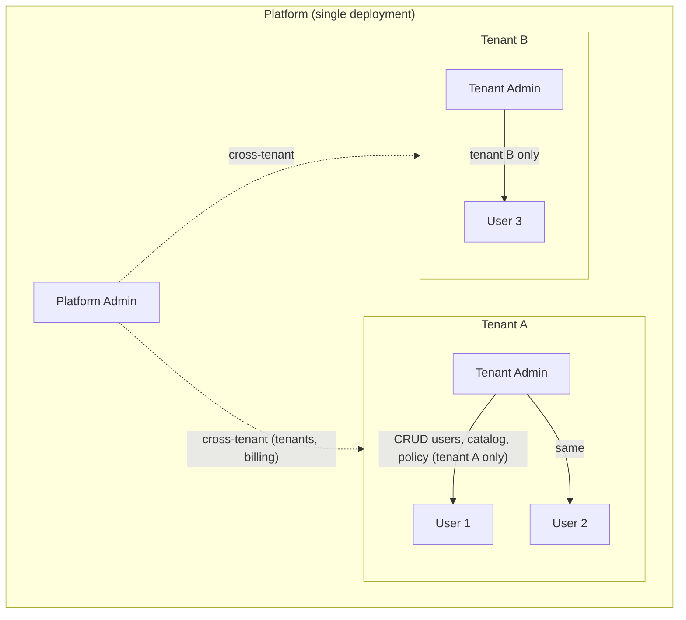
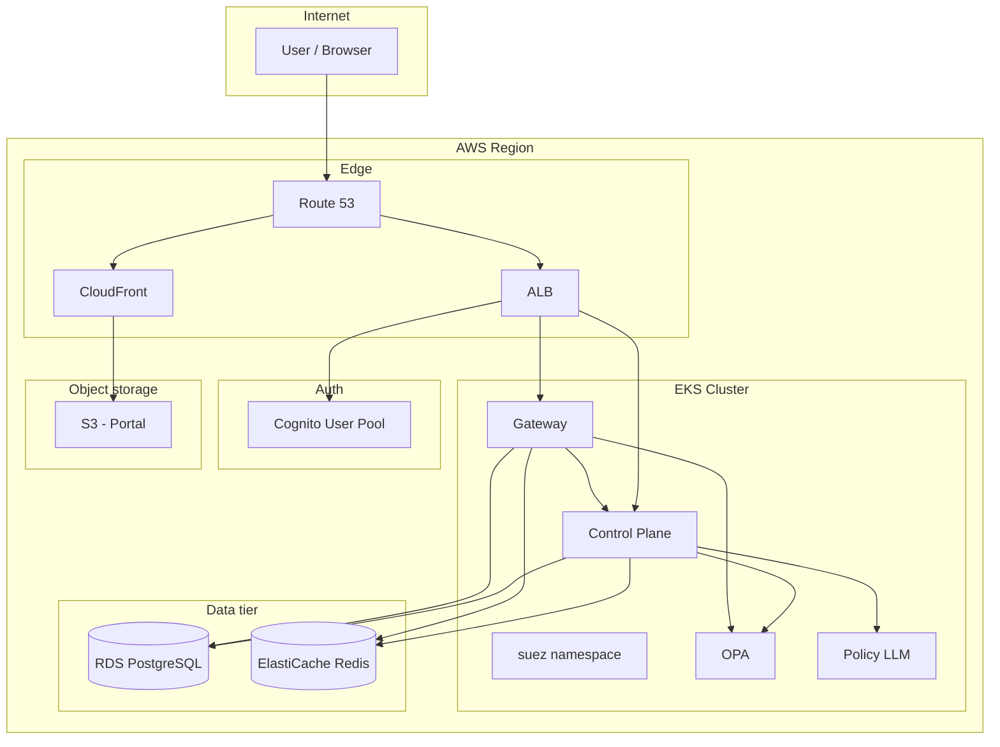

# Suez SaaS: Detailed Technical Architecture

This document describes the **technical architecture of Suez as an enterprise SaaS** deployment. It is limited to the SaaS delivery model on AWS: multi-tenancy, EKS-based runtime, identity and auth, data isolation, and operational boundaries. For the local (Compose) architecture, see **../architecture.md**. For product vision and roadmap, see **enterprise-saas-aws.md** (this directory).

---

## 1. Scope and assumptions

**In scope**

- Single-tenant logical view per customer (tenant); shared platform runtime and data tier.
- AWS as the sole hosting environment: EKS, RDS, ElastiCache, ALB, CloudFront, S3, Cognito, Secrets Manager.
- Identity: API keys (tenant-scoped), JWT (Cognito after SAML), and internal identity resolution.
- Control Plane, Gateway, OPA, Policy LLM (open source), and Portal as the core application set.
- Data isolation by `tenant_id`; optional Row-Level Security (RLS) in PostgreSQL.
- Audit and observability for compliance and operations.

**Out of scope for this document**

- Local or on-premises deployment (see docs/architecture.md).
- Detailed implementation steps (see implementation-plan-aws.md in this directory).
- Product roadmap and feature list (see enterprise-saas-aws.md in this directory).

---

## 2. Logical architecture

### 2.1 Tenant and role model

Every customer is a **tenant**. Tenants do not share data; they share the same Control Plane, Gateway, database (with tenant partitioning), and a shared **Redis** deployment used by the **gateway** for quotas, chat cache, and stats (the control plane does not store tenant data in Redis in the current implementation).



| Role | Identity store | Scope | Typical actions |
|------|----------------|--------|------------------|
| **Platform Admin** | IAM Identity Center group or platform table | All tenants | Create/suspend tenants, platform config, support, billing. |
| **Tenant Admin** | `users` with `role=tenant_admin` | One tenant | Create users, API keys; register models/tools; approve/deny requests; manage policy; view tenant audit. |
| **User** | `users` with `role=user` | One tenant | Request access; use granted models/tools; run agents. |

All API and Gateway requests are bound to a **tenant** and **actor** (user or API key identity). The Control Plane and Gateway enforce scope on every call; the Portal only exposes data for the caller’s tenant (or all tenants for Platform Admin).

### 2.2 Component boundaries

| Component | Responsibility | Consumes | Exposes |
|-----------|----------------|----------|---------|
| **Portal** | Web UI for Admin and Requester workflows. | Control Plane API, Gateway API. | Static assets (S3/CloudFront); no server-side session store. |
| **Control Plane** | Config API, identity resolution, policy lifecycle, audit storage. | PostgreSQL; OPA and Policy LLM for health/generate; **Redis** is not used for application state in the current codebase (local Compose still expects Redis up for `/healthz` TCP check). | REST API; internal `/internal/auth/resolve` for Gateway. |
| **Gateway** | Runtime enforcement: resolve identity, check grants, call OPA, enforce quota, cache, call upstream. | Control Plane (resolve), PostgreSQL (catalog, grants), Redis (quota, cache), OPA (decision). | REST: `/v1/chat/completions`, `/v1/tools/execute`, `/v1/identity`, `/v1/observability`. |
| **OPA** | Authorization decisions (allow/deny + reasons). | Policy bundle (from Control Plane or S3). | HTTP API: `/v1/data/suez/authz/decision`. |
| **Policy LLM** | Generate Rego from natural language (draft only). | — | HTTP (Ollama-compatible); used by Control Plane on demand. |

Control Plane and Gateway are **stateless**; tenant and request context are derived on each request. OPA is stateless; policy is loaded from bundle. Policy LLM is used only at draft time, not on the request path.

---

## 3. Physical architecture (AWS)

### 3.1 Region and high-level layout

A single **AWS region** is assumed. All resources (EKS, RDS, ElastiCache, ALB, S3, CloudFront, Cognito) live in one region. Multi-region is not covered here.



### 3.2 Network topology

- **VPC**: One VPC per environment (e.g. prod). Public subnets for ALB and NAT Gateway; private subnets for EKS node groups, RDS, and ElastiCache.
- **EKS**: Cluster endpoint can be private (recommended) or public with restricted CIDR. Node groups run in **private subnets**; outbound via NAT Gateway.
- **RDS**: PostgreSQL in a **DB subnet group** (private subnets). No public IP. Security group allows 5432 from EKS node (or pod) security group only.
- **ElastiCache**: Redis in private subnets. Security group allows 6379 from EKS only.
- **ALB**: In public subnets. Listener 443 (HTTPS, ACM). Target groups point to EKS Services (NodePort or Instance mode per AWS Load Balancer Controller).
- **CloudFront**: Optional. Origin for portal = S3 (and optionally a second origin for API = ALB). TLS via ACM; custom domain (e.g. `suez.acrosystems.ai`).

### 3.3 EKS topology

- **Cluster**: One EKS cluster. Kubernetes version 1.28+.
- **Namespace**: Application workloads in **`suez`** namespace. No per-tenant namespaces; tenant isolation is data-level.
- **Workloads**:
  - **control-plane**: Deployment; replica count ≥ 1; Service ClusterIP 8081.
  - **gateway**: Deployment; replica count ≥ 1; Service ClusterIP 8080; scale by HPA (CPU or custom metric).
  - **opa**: Deployment; Service ClusterIP 8181; policy bundle from init container or S3.
  - **policy-llm**: Deployment (Ollama); Service ClusterIP 11434; PVC for model cache; optional Job to pull model once.
- **Ingress**: One Ingress resource in `suez` with AWS Load Balancer Controller annotations. Paths: e.g. `/control-plane` → control-plane:8081, `/gateway` → gateway:8080. TLS at ALB (ACM). Path stripping so backends receive `/api/...` and `/v1/...` as expected.
- **Secrets**: DB and third-party API credentials in **Secrets Manager**. **External Secrets Operator** (or Secrets Store CSI) syncs them into Kubernetes Secrets in `suez`; Control Plane and Gateway mount or env-from them. No secrets in repo or container images.

### 3.4 Identity and TLS

- **Portal**: Served over HTTPS (CloudFront or ALB). Unauthenticated users are redirected to Cognito Hosted UI (or login form for API key). After login, Portal stores JWT or treats API key as session; all API calls use `Authorization: Bearer <JWT>` or `Authorization: ApiKey <key>` (or `X-API-Key`).
- **Control Plane / Gateway**: No mutual TLS between browser and ALB; TLS is termination at ALB. Internal traffic (Gateway → Control Plane, Gateway → OPA) is cluster-internal HTTP (no TLS inside the mesh unless explicitly configured).
- **Cognito**: User Pool with SAML IdP (e.g. IAM Identity Center). App client: authorization code grant. Custom attributes or claims for `tenant_id` and `role` so Control Plane can build identity context without a separate lookup when JIT provisioning is used.

---

## 4. Request path (SaaS)

### 4.1 Portal → Control Plane (e.g. list models)

1. User has signed in; Portal holds JWT or API key.
2. Browser: `GET https://suez.acrosystems.ai/control-plane/api/v1/models` with `Authorization: Bearer <JWT>` or `ApiKey <key>`.
3. DNS → ALB → Ingress → Control Plane Service → Control Plane pod.
4. Control Plane: validate credential (JWT or API key), resolve to identity context (tenant, actor, roles). Enforce tenant scope: query `models` where `tenant_id = identity.tenantId`. Return JSON.
5. Portal renders the list.

### 4.2 Portal → Gateway (e.g. chat completion)

1. User selects model and sends message. Portal: `POST https://suez.acrosystems.ai/gateway/v1/chat/completions` with same `Authorization` and body `{ model, messages }`.
2. ALB → Gateway pod.
3. Gateway: call Control Plane `GET /internal/auth/resolve` with same `Authorization` header. Control Plane returns identity context (or 401).
4. Gateway: lookup model by `tenant_id` + `external_name`; check `access_grants` for (tenant, actor, model); call OPA with (action=chat.completions, identity, resource, request); check quota in Redis; check cache in Redis; if miss, call upstream (OpenAI-compatible or Groq or stub); write audit row; set cache; return response with `X-Suez-Cache`, `X-SUEZ-Trace-Id`.
5. Portal displays the reply and optional raw payload.

### 4.3 Sequence (Gateway chat, simplified)

```mermaid
sequenceDiagram
    participant Browser
    participant ALB
    participant GW as Gateway
    participant CP as Control Plane
    participant DB as PostgreSQL
    participant OPA as OPA
    participant Redis as Redis
    participant Upstream as Upstream API

    Browser->>ALB: POST /gateway/v1/chat/completions (Bearer JWT)
    ALB->>GW: same
    GW->>CP: GET /internal/auth/resolve (Bearer JWT)
    CP->>CP: Validate JWT; load tenant + user
    CP->>GW: 200 { identityContext }
    GW->>DB: model + grant lookup (tenant, actor)
    GW->>OPA: decision (identity, resource, request)
    OPA->>GW: { allow, reasons }
    GW->>Redis: quota + cache
    alt cache HIT
        GW->>Browser: 200 + cached (X-Suez-Cache: HIT)
    else cache MISS
        GW->>Upstream: POST chat/completions
        Upstream->>GW: response
        GW->>DB: audit
        GW->>Redis: set cache
        GW->>Browser: 200 + response (X-Suez-Cache: MISS)
    end
```

---

## 5. Identity and authentication (SaaS)

### 5.1 Credential types

| Type | Used by | Flow |
|------|---------|------|
| **API key** | Portal (Admin/Requester) or API clients | Header `Authorization: ApiKey <key>` or `X-API-Key`. Control Plane looks up key (hash), returns tenant + actor (e.g. key label or linked user). |
| **JWT (Cognito)** | Portal after SSO | Header `Authorization: Bearer <id_token>`. Control Plane validates JWT (JWKS from Cognito), extracts claims (sub, custom tenant/role). Optional JIT: create/update `users` row and return identity context. |
| **SAML** | Not directly | User signs in at IdP → Cognito (SAML SP) → Cognito issues JWT. Suez never sees SAML; it only sees the JWT. |

### 5.2 Identity context (internal)

After resolution (API key or JWT), the Control Plane returns a single **identity context** object used by the Gateway and by the Control Plane’s own authorization:

- `tenantId`, `tenantSlug`, `tenantName`
- `actor` (user id, email, or key label)
- `authMethod` (e.g. `api_key`, `jwt`)
- `apiKeyId` or `jwtSubject` (if applicable)
- `roles` (e.g. `["tenant_admin"]` or `["user"]`)
- `authenticatedAt` (ISO timestamp)
- Optional: `claims`, `metadata`

The Gateway does not parse JWT or API keys; it always calls the Control Plane’s `/internal/auth/resolve` and trusts the returned context. All grant checks, OPA input, quota keys, and audit rows use this context.

### 5.3 Internal auth endpoint

- **URL**: `GET /internal/auth/resolve` (Control Plane).
- **Caller**: Gateway only (or other trusted services). Not exposed to the browser; ALB/Ingress can restrict by path or allow only from Gateway Service.
- **Request**: Forward `Authorization` and/or `X-API-Key` from the original client.
- **Response**: 200 `{ "identityContext": { ... } }` or 401.

---

## 6. Multi-tenancy and data isolation

### 6.1 Database

- **Single RDS instance**, one database (e.g. `suez`). All tenant-scoped tables have **`tenant_id`** (UUID FK to `tenants`).
- **Queries**: Every Control Plane and Gateway query that reads or writes tenant data must include `tenant_id` from the identity context. No global “list all tenants’ models” except for Platform Admin.
- **Row-Level Security (RLS)**: Optional. PostgreSQL policies can enforce that the current role only sees rows where `tenant_id` matches a session variable set from the identity context. Application code still passes `tenant_id`; RLS is a second enforcement layer.
- **Schema-per-tenant**: Not used in the default design. Possible for stronger isolation at the cost of migrations and operational complexity.

### 6.2 Redis

- **Keys**: All keys that carry tenant or user state include tenant (and optionally actor) in the key name so that:
  - Quota: `quota:{tenantId}:{actor}:{resource}:{bucket}:rpm` (and `:tpm`).
  - Cache: `suez:chat:{tenantId}:{model}:{hash}`.
  - Stats can be global (e.g. `suez:stats:chat_requests`) or per-tenant if needed.
- **No cross-tenant key**: Key design and code review ensure no key is shared across tenants.

### 6.3 Application enforcement

- **Control Plane**: All list/create/update handlers for tenants, users, models, tools, requests, grants, policies, and audit are scoped by `identity.TenantID` (or allow Platform Admin to pass tenant). No endpoint returns another tenant’s data to a non–Platform Admin.
- **Gateway**: Model and tool lookup is by `(tenant_id, external_name)` or `(tenant_id, name)`. Grant check is by `(tenant_id, actor, resource_type, resource_name)`. Audit rows are written with `tenant_id` and `actor` from identity context.

---

## 7. Security (SaaS)

### 7.1 Network

- EKS nodes and RDS/ElastiCache in private subnets. Ingress from internet only via ALB (and CloudFront if used). No direct exposure of Control Plane or Gateway to the public internet except through the ALB.
- Security groups: ALB allows 443 from 0.0.0.0/0 (or restricted IPs). EKS node SG allows traffic from ALB to NodePort/target. RDS/ElastiCache SGs allow only from EKS node (or pod) SG.

### 7.2 IAM (IRSA)

- Control Plane and Gateway pods use **IRSA** (IAM Roles for Service Accounts). No long-lived AWS keys in env or images. Pods assume a role that has:
  - **Secrets Manager**: `GetSecretValue` on the secrets used for DB and optional third-party API keys.
  - **S3** (optional): GetObject for OPA bundle or policy artifacts.
- Policy LLM (Ollama) does not need AWS permissions; it is called over HTTP from the Control Plane.

### 7.3 Secrets

- **Secrets Manager**: Master DB password, Redis URL, third-party API keys (e.g. OpenAI, Groq), Cognito JWKS or SAML certs if needed. Encryption with KMS.
- **Kubernetes**: External Secrets Operator (or CSI driver) syncs Secret Manager entries into K8s Secrets. Control Plane and Gateway reference these via `envFrom` or `volumeMount`. Rotation is in Secrets Manager; ESO/CSI refresh syncs into the cluster.

### 7.4 Audit and compliance

- Every governed action (model call, tool run, access decision, policy publish) produces an **audit log** row: tenant_id, actor, action, resource_type, resource_name, decision, trace_id, timestamp, optional metadata. Logs are immutable (append-only) and queryable via Control Plane API (with tenant scope). Export to SIEM or compliance tooling via API or batch job.

---

## 8. Data tier (SaaS)

### 8.1 RDS PostgreSQL

- **Engine**: PostgreSQL 16 (or 15). Multi-AZ for production.
- **Instance**: Size per load (e.g. db.t3.medium). Storage encrypted (KMS).
- **Connectivity**: From EKS via private subnet; security group allows 5432 from EKS. No public access.
- **Credentials**: In Secrets Manager; connection string (or components) synced into K8s and used as `DATABASE_URL` (or equivalent) by Control Plane and Gateway.
- **Backup**: Automated backups (e.g. 7-day retention). Optional manual snapshot before major changes.

### 8.2 ElastiCache Redis

- **Engine**: Redis 7. Cluster mode off for simplicity (or on for scaling).
- **Node type**: e.g. cache.t3.small. Encryption in transit optional but recommended.
- **Connectivity**: From EKS only; security group allows 6379 from EKS.
- **Usage**: Quota counters, response cache, gateway stats. No persistent business data; cache can be flushed without loss of correctness.

---

## 9. Scaling and availability

- **Control Plane**: Stateless; scale by increasing replica count. No local session; identity is resolved per request.
- **Gateway**: Stateless; scale by replica count and HPA. Sticky session not required; any pod can serve any request.
- **OPA**: Stateless; single replica is sufficient for moderate load; scale out if decision latency requires.
- **Policy LLM**: Optional; one or few replicas; model load is on-demand (draft generation), not request path.
- **RDS**: Single primary; read replica optional for read-heavy reporting. Failover via Multi-AZ.
- **Redis**: Single node or cluster; ElastiCache handles failover. Quota and cache are best-effort under failure; requests can fall back to no-cache or reject under overload.

---

## 10. Observability

- **Logs**: Container stdout/stderr to **CloudWatch Logs** (e.g. Fluent Bit DaemonSet or sidecar). Log groups per namespace or app. No PII in logs; trace_id can be used to correlate with audit.
- **Metrics**: **Container Insights** (or Prometheus) for pod CPU/memory and optional app metrics. Gateway can expose a simple `/metrics` or rely on CloudWatch.
- **Audit**: Stored in PostgreSQL; queryable via Control Plane API. Optional export job to S3 or external SIEM.
- **Alarms**: CloudWatch Alarms on RDS CPU/connections, ElastiCache memory/evictions, ALB 5xx/4xx, and (if available) EKS pod restarts or deployment not ready. Notifications via SNS.

---

## 11. API surface (SaaS reference)

### 11.1 Control Plane (base path e.g. `/control-plane`)

| Method | Path | Auth | Description |
|--------|------|------|-------------|
| GET | `/api/v1/bootstrap/status` | No | Demo credentials and checks (for Portal). |
| GET | `/internal/auth/resolve` | Header forwarded by Gateway | Returns identity context; used only by Gateway. |
| POST | `/api/v1/auth/session` | ApiKey or Bearer | Returns identity context for Portal. |
| GET/POST | `/api/v1/tenants` | Yes (Platform Admin for create) | List or create tenants. |
| GET/POST | `/api/v1/api-keys` | Yes | List or create API keys (tenant-scoped). |
| GET | `/api/v1/access-requests` | Yes | List access requests (tenant-scoped). |
| POST | `/api/v1/access-requests` | Yes | Create access request. |
| POST | `/api/v1/access-requests/:id/approve`, `.../deny` | Yes | Approve or deny request. |
| GET | `/api/v1/access-grants` | Yes | List grants (tenant-scoped). |
| GET/POST | `/api/v1/models` | Yes | List or create models (tenant-scoped). |
| GET/POST | `/api/v1/tools` | Yes | List or create tools (tenant-scoped). |
| GET/POST | `/api/v1/policies` | Yes | List or create policies (tenant-scoped). |
| GET/POST | `/api/v1/policies/generate` | Yes | Generate Rego from natural language. |
| GET | `/api/v1/policies/:id/tests`, `.../versions` | Yes | Policy tests and version history. |
| POST | `/api/v1/policies/:id/validate`, `.../tests/run`, `.../publish`, `.../rollback` | Yes | Policy lifecycle. |
| GET | `/api/v1/audit-log`, `/api/v1/audit-log/traces/:id` | Yes | Audit log and trace detail (tenant-scoped). |

All authenticated routes require a valid API key or JWT; identity is derived and tenant scope applied.

### 11.2 Gateway (base path e.g. `/gateway`)

| Method | Path | Auth | Description |
|--------|------|------|-------------|
| GET | `/` | No | Service info and routes. |
| GET | `/healthz` | No | Health and dependency checks. |
| GET | `/v1/identity` | Yes | Returns resolved identity context. |
| POST | `/v1/chat/completions` | Yes | OpenAI-style chat completion (grant, OPA, quota, cache, upstream). |
| POST | `/v1/tools/execute` | Yes | Execute tool by name with JSON input. |
| GET | `/v1/observability` | Yes | Cache entries, cache hits, chat request count (Redis). |

Protected routes require `Authorization` or `X-API-Key`; Gateway resolves identity via Control Plane before processing.

---

## 12. Document references

| Topic | Document |
|-------|----------|
| Local / Compose architecture | **../architecture.md** |
| SaaS vision, roadmap, SSO, agents | **enterprise-saas-aws.md** (this directory) |
| Step-by-step AWS deployment | **implementation-plan-aws.md** (this directory) |
| Operations and troubleshooting | **../operations.md**, **../troubleshooting.md** |

This technical architecture is the single reference for the **Suez SaaS** deployment on AWS. Changes to tenant model, component boundaries, or data isolation should be reflected here first.
